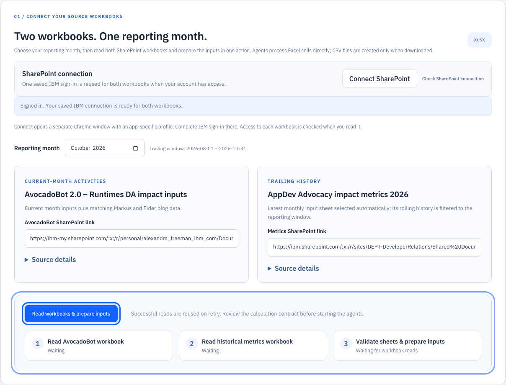
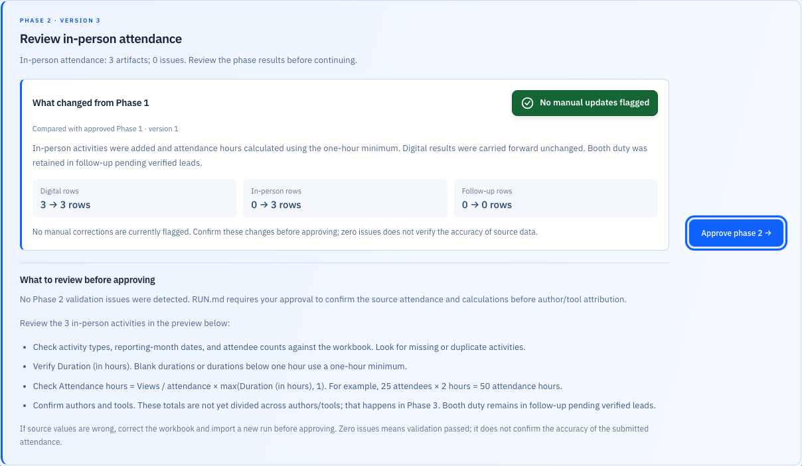
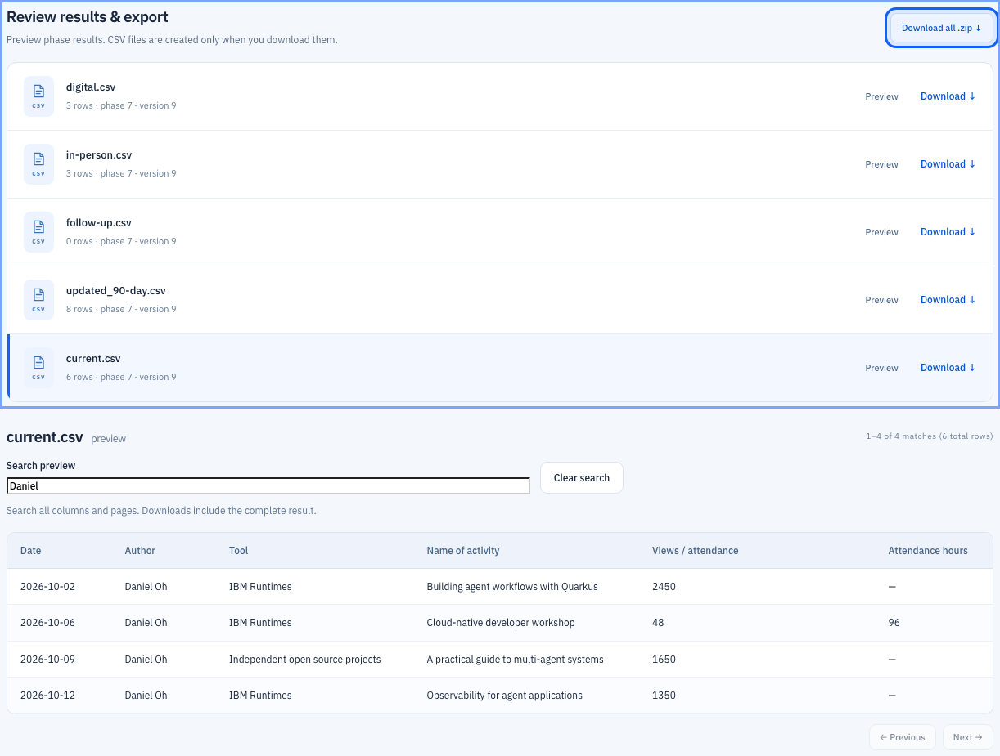

# Impact Metrics AppDev

Quarkus LangChain4j application and React SPA for all seven RUN metrics phases. Read two SharePoint workbooks, select a reporting month, review phase approvals, enter verified measurements, preview results, and download CSVs or a ZIP. Workbook cells feed specialized agents and Java decimal calculations directly. CSV files are generated in memory only when downloaded; no intermediate CSV files are created. No IBM Bob or Python execution is required.

## See the workflow

The screenshots below use representative sample data to illustrate the interface.

### 1. Connect your SharePoint workbooks

Choose a reporting month, connect once, and read both workbooks with one action. Source details and progress make each step easy to follow.



### 2. Review what the agents changed

Each checkpoint highlights changes from the previous phase, any manual updates needed, and the next approval action.



### 3. Search your results and export

Filter preview rows by author, tool, activity, or other cell text across every page. Download individual CSV files or the complete ZIP when the run is ready.



## Start locally

Requires Java 25+, Node 20.19+ or 22.12+, and npm. The Maven wrapper is included. On this Mac, `dev.sh` finds the installed SDKMAN/Homebrew JDK when system Java is not configured. Select a Java 25+ installation.

```bash
cd /Users/danieloh/developer-advocacy/tools/impact-metrics-appdev
./dev.sh
```

Open **http://127.0.0.1:8097**. Quinoa builds and serves the SPA through Quarkus; no separate frontend server is needed. First startup requires dependency downloads. Override the port with `./dev.sh -Dquarkus.http.port=8098` if necessary.

Connect SharePoint once with your IBM account and choose the reporting month, then select **Read workbooks & prepare inputs**. Both editable URL fields start with the supplied defaults. The app reads both sources and prepares their selected sheets sequentially. Ambiguous selections pause for review. If a step fails, **Retry failed step** reuses successful snapshots; independent re-read controls are available under each workbook’s **Source details**. Accept the calculation contract and start the agents. Approve phases 1–4 as applicable; phases 5–7 finish automatically. CSV/local Excel import controls and runtime seed import endpoints are removed. Download results individually or as ZIP.

Restarted/interrupted runs become retryable and resume from immutable phase inputs. Successful measurements are cached per run. Approvals reference exact artifact versions; edits generate fresh versions.

## Workbook-first agent processing

The app's `runtimes/RUN.md` and `runtimes/AGENTS.md` now describe the Quarkus workbook workflow rather than Python scripts or Bob commands. Existing runs keep their frozen instructions; create a new run to use the updated rules.

WorkbookPreparationAgent reads Excel cells directly into structured row data. That data feeds all phase agents without serializing and reparsing CSV. A comma in a name/title is ordinary text; Excel cell boundaries define columns. Semicolons and line breaks inside Author/Tool cells explicitly separate multiple values for attribution. A numeric cell uses its stored value, including the saved result of a formula, rather than a formatted `1,000`, currency, or percentage display. Dates retain their source date/month handling. Input CSV snapshots are generated only on demand from immutable source data, and older saved runs remain readable.

For a **current-month digital activity without a URL**, valid nonnegative `Views / attendance` and numeric `Duration (in hours)` let it proceed into `digital.csv` without a manual collection warning. Supplied view counts remain views; only in-person rows multiply attendance by the minimum-one-hour duration. Zero views is valid. Missing values still require collection; invalid supplied values require correction. This rule does not bypass a URL's provider collection or replace the fresh lifetime totals needed for trailing deltas.

## Two SharePoint workbook inputs

The preparation agent uses the existing [Quarkus Apache POI extension](https://docs.quarkiverse.io/quarkus-poi/dev/index.html). Each workbook is read separately and held as a snapshot; changing the reporting month reuses those snapshots.

| Source | Default link and use |
|---|---|
| Current activities | [AvocadoBot 2.0 – Runtimes DA impact inputs](https://ibm-my.sharepoint.com/:x:/r/personal/alexandra_freeman_ibm_com/Documents/Developer%20Relations/Really%20useful%20numbers%20(RUN)/Inputs/AvocadoBot%202.0%20-%20Runtimes%20DA%20impact%20inputs.xlsx?d=wc4b8fb9134a44856ac3980cc9b39c53f&csf=1&web=1&e=7Ja7w9): selected current sheet plus reporting-month Markus/Elder blog rows |
| Trailing history | [AppDev Advocacy impact metrics 2026](https://ibm.sharepoint.com/:x:/r/sites/DEPT-DeveloperRelations/Shared%20Documents/Really%20Useful%20Numbers%20(RUN)/Advocacy/2026/Working%20data/AppDev%20Advocacy%20impact%20metrics%202026.xlsx?d=w17d51aa602214ef29e2d761379e0b65f&csf=1&web=1&e=BdC23f): month-named sheets such as August inputs and September inputs |

Monthly input sheets already contain rolling history. Choose **one latest monthly input sheet** at or before the selected reporting month, within its three-month window, then filter activity dates. For October 2026, use October inputs when present, or September inputs when October is absent, and include only August 1–October 31 dates. For September, use September inputs and July 1–September 30 dates. Do not combine August/September snapshots: their activities overlap and their baselines reflect different reporting periods. The selected baseline sheet and fallback are visible in the SPA. Missing dated months are highlighted; unavailable data is never invented. Matching hidden, invalid, or ambiguous latest sheets block preparation. The server derives the same choice from the month. Explicit years in sheet names are respected; date filtering always constrains the year. Other workbook sheets and AvocadoBot's previous-month sheets never supply history.

Historical Current total values remain the previous baselines. Missing, negative, or invalid baselines require Phase 4 review only for rows calculating a delta; fresh totals never substitute for historical measurements. Author × tool splits conserve recorded totals. Each prepared row records its source workbook/sheet. This is a three-calendar-month window, not exactly 90 elapsed days.

The workbook requires `Date of activity` (or `Date`), `Author of activity` (or `Author`), `Type of activity`, and `Link / URL to resource` headers in the first 30 rows of each selected sheet. Header matching ignores case, repeated whitespace, line breaks, and nonbreaking spaces. The raw workbook header **Link / URL to public resource** maps to **Link / URL to resource**; scoped headers such as **Author of activity (Java Runtime)** and **Tool (Java Runtime)** map to **Author of activity** and **Tool**. Content/deck and trip-report links stay separate and are not substituted for a missing public URL. Extra named columns are retained. Excel dates, ISO dates, and US M/D/YYYY dates are supported. Formula cells use saved cached values; recalculate and save in Excel first. The application never evaluates formulas, macros, or external links. Hidden sheets are excluded. Invalid dates, duplicate headers after normalization, Excel errors, and data without headers are rejected with a readable message. Limits: 100 sheets, 20,000 rows per sheet, and 100 columns.

The two blog sheets supplement the current input automatically from the AvocadoBot SharePoint snapshot. **Markus blog data** is filtered by `Date`; **Elder blog data** is filtered by `Month`. The UI shows each sheet's matching count when you change the reporting month. Their source-specific columns map as follows:

| Blog source column | Generated activity column |
|---|---|
| `Date` / `Month` | `Date of activity` |
| `Name` | `Author of activity` |
| `Title` | `Name of activity` |
| `Link` / `blog` | `Link / URL to resource` |
| `Views` / `views` | `Views / attendance` |
| `Type` | `Type of activity`; blank values default to `Blog post / slide shares / .io updates` |
| `Current`, `Previous`, `Trailing` | `Current total`, `Previous total`, `Trailing 90-day` |

Tool, author, title, URL, saved view counts, and other source values are preserved. Supported month values include Excel dates, ISO/US dates, `2026-09`, `Sep 2026`, and `September 2026`. A month-only value uses its first day for grouping and records `Source date precision = Month only`; it does not claim an exact publication day. Every appended row records `Source sheet` and `Source row`. Rows with blank Date/Month are excluded and counted in a visible warning; fill their month in Excel and read the workbook again to include them. Invalid nonblank dates or malformed visible blog sheets produce a validation error. Hidden blog sheets remain excluded. No dates, URLs, authors, or view counts are invented. Blog supplements are not offered as primary/history sheets, preventing accidental double import; they append to the current input only. Their per-sheet appended and undated counts are saved in run state as `blogRows` and `blogSkippedRows`, and shown under **Prepared workbook inputs**. A month can be prepared from matching blog rows even when the selected primary sheet has no rows for that month. Historical inputs come exclusively from the separate metrics workbook; baseline review rules remain unchanged.

If historical sheets contain only raw submissions without processed `Current total` values, the app can generate the trailing input, but those activities require verified baseline entry during phase 4. Fresh scraped totals cannot reconstruct historical totals. No trailing dataset is prepared when no activities qualify; no input CSV is created unless downloaded.

Both optional input CSV snapshots use UTF-8 and are generated in memory when downloaded from **Prepared workbook inputs**; preparation does not create CSV files. Both original workbooks are preserved as `rawdata/original.xlsx` and `rawdata/trailing-original.xlsx` under their run; filenames, sheet choices, reporting month, date window, SHA-256, and missing-baseline count are recorded in run state. All workbook data remains inside ignored `runtimes/runs/` storage.

Inspection includes `suggestedCurrentSheet` and `suggestedHistorySheets`; the SPA uses these recommendations for SharePoint imports. Excluded sheets report the missing activity-header structure or hidden status. A sheet row count describes all dated rows before the reporting-month/window filters.

## SharePoint connection and snapshots

The shared **Connect SharePoint** control normally opens AvocadoBot in a separate local Chrome window with an app-specific profile. Complete IBM SSO/MFA. Saved browser cookies/storage are reused for both `ibm-my.sharepoint.com` and `ibm.sharepoint.com`; the workbook read redeems its original link if site access needs refreshing. A single sign-in is sufficient when IBM SSO and both workbook permissions allow it. If the second site requires interactive sign-in, a failed read shows a reconnect message and Connect opens that workbook. Your account still needs download access to each file. Other hosts, credentials in URLs, traversal paths, non-HTTPS and non-XLSX files are rejected.

Each read has its own progress, error, and ready state; failure or link editing invalidates only that workbook's snapshot. Preparation requires both valid independent snapshots. The cache holds five snapshots for 30 minutes; consumed/expired tokens return HTTP 410 and require rereading. Original bytes are stored as `rawdata/original.xlsx` and `rawdata/trailing-original.xlsx` with separate filenames, canonical source URLs without sharing queries, and SHA-256 hashes. All private data stays in ignored runtimes storage. CSVs are generated only for requested downloads.

The indeterminate progress UI shows actual download/validation/sheet-inspection stages and elapsed time. It does not invent a percentage. HTTP 401 requires reconnecting; HTTP 403, missing files, invalid workbooks and timeouts have specific errors. Chrome is required locally; `METRICS_SHAREPOINT_BROWSER_CHANNEL`, `METRICS_SHAREPOINT_BROWSER_EXECUTABLE`, and `METRICS_SHAREPOINT_ENABLED` configure the integration. Reset preserves saved sessions. Passwords/cookies are never sent to model agents.

Endpoints: `GET/POST /api/sharepoint/session`; `POST /api/workbooks/from-sharepoint` with JSON `url`; `POST /api/runs/from-sharepoint` with multipart `sourceToken`, `historySourceToken`, `month` and `currentSheet`. Historical sheet selection is server-derived. `GET /api/runs` lists saved runs; POST CSV import, `/api/runs/from-runtimes`, `/api/runs/from-workbook`, and `/api/workbooks/inspect` have been removed. Input/result download endpoints remain available, including audit snapshots named AvocadoBot 2.csv and trailing_90-day.csv. Existing runs preserve their frozen instructions; create a new run for the two-source contract.

References: [SharePoint authentication](https://learn.microsoft.com/en-us/sharepoint/authentication), [Playwright authentication state](https://playwright.dev/java/docs/auth), [authenticated HTTP requests](https://playwright.dev/java/docs/api/class-apirequestcontext).

## Web interface


The **AppDev Developer Advocacy** workspace uses self-hosted IBM Plex Sans, a navy sidebar, blue action controls, and responsive cards for imports, run summaries, collection review, and exports. The mobile layout keeps workspace identity and recent runs accessible. Keyboard focus indicators, a skip link, and reduced-motion support are included; fonts load locally without third-party requests.

## Source structure

Backend packages under `src/main/java/com/ibm/advocacy` separate responsibilities:

```text
agentic/   # individual phase agents, sequence workflow, and model reviewers
model/     # row/run data, measurements, approvals, artifacts, and CSV schema
resource/  # REST endpoints and API error mapping
service/   # durable run orchestration, seven-phase pipeline, decimal calculations
collector/ # public metrics providers and authenticated LinkedIn collection
csv/       # CSV parsing, encoding, and serialization
storage/   # runtimes boundary and atomic state/file persistence
```

`src/test/java/com/ibm/advocacy/service` contains calculation and workflow integration tests. The React SPA remains in `src/main/webui`, with Quarkus configuration in `src/main/resources`. Package refactoring preserves REST paths, CSV formats, and persisted run JSON; runtime data stays in `runtimes`.

## Runtime storage

All production raw data and outputs stay under `runtimes`. Seed CSVs remain in place; the app never processes the original project's `ai` or `devops` folders.

```text
runtimes/
  RUN.md
  AGENTS.md
  AvocadoBot 2.csv
  trailing_90-day.csv
  runs/<run-id>/
    rawdata/           # original.xlsx + trailing-original.xlsx; older saved CSV uploads
    instructions/     # frozen instruction snapshots
    state/            # atomic state, measurements, approvals, row lineage
    output/<version>/ # immutable JSON result datasets, e.g. digital.json
  .sessions/          # optional LinkedIn browser profile
  .uploads/           # temporary multipart uploads
```

Git excludes runtime CSVs, every file under `runtimes/runs/`, sessions, uploads, and future rawdata/output folders. Only `runtimes/RUN.md` and `runtimes/AGENTS.md` are versioned.

Filesystem access rejects traversal and symlink escapes. Current input and workbook-generated inputs are UTF-8; separately uploaded legacy trailing CSVs are Windows-1252; exports are UTF-8. Structured phase datasets retain source columns and row IDs. `current.csv` uses the exact 24-column RUN schema.

The contract fixes the legacy script gaps: unresolved digital rows are exclusively follow-up; attribution divides by authors × tools and conserves totals at six decimals; in-person Views / attendance contains allocated attendance hours; trailing totals preserve previous baselines, allocate shared URL totals once, and calculate deltas. Negative deltas remain visible. Phase-5 and unknown activity types are retained. Booth-lead collection and later follow-up recalculation require a separate request.

RUN.md and AGENTS.md must match the reviewed instruction SHA-256 in `metrics.instructions.sha256`. If instructions change, review and implement the new rules before updating that hash. Each run freezes its own copies.

## Agents and optional model review

`agentic.PhaseWorkflow` is a LangChain4j sequence of InstructionAgent, DigitalMetricsAgent, AttendanceAgent, AttributionAgent, Trailing90Agent, ExportAgent, and ValidationAgent, with isolated AgenticScope IDs. Durable Java orchestration enforces approvals and recovery.

Plain Java agents perform exact calculations and I/O. Optional InstructionReviewer and QualityReviewer model agents explain bounded contract/phase summaries. Models cannot invent measurements or approve phases. The complete workflow runs without model credentials; commentary is disabled by default.

To enable commentary before starting, set `METRICS_AI_ENABLED=true`, `METRICS_MODEL_API_KEY`, `METRICS_MODEL_BASE_URL`, and `METRICS_MODEL_NAME`. The configured endpoint must support the OpenAI-compatible chat API. Frozen instructions and bounded issue summaries are sent to it; full CSVs and personal columns are not sent. Model failures preserve deterministic processing.

## Collection and LinkedIn

Public collectors support DZone article Views, YouTube viewCount, GitHub repository stars, and Terraform Registry provider downloads, with fixed hosts, private-address checks, bounded redirects, timeouts, and response-size limits. Unsupported sites and provider/rate-limit failures create manual tasks. Evidence and collection timestamps are saved.

For LinkedIn, run `npx playwright install chromium` from `src/main/webui`, then choose **Connect LinkedIn** and sign in to the dedicated browser window. Use **Check connection**, then **Retry unresolved collection** at the current review. Set `METRICS_LINKEDIN_ENABLED=false` to disable browser collection.

Posts/feed/pulse use total reactions only. Events follow the admin post-analytics link and require **Video Views** from Video performance. Lifetime unique viewers and peak concurrent viewers are not accepted substitutes. Missing login/admin access or changed markup falls back to manual entry. Authenticated LinkedIn collection and live LLM responses have not been verified in this session.

## Reset run history

Saved runs persist across dev-mode restarts in `runtimes/runs/`; this application stores history in files rather than PostgreSQL. Choose **Reset run history** in the sidebar and confirm **Delete all run history** to clear every saved run, its uploaded copies, measurements, approvals, and output versions. The SPA then clears the selected run, previews, counters, and browser's remembered run ID.

Reset keeps `RUN.md`, `AGENTS.md`, and `.sessions/` for SharePoint/LinkedIn authentication. Older files directly under runtimes also remain; the app no longer imports seed CSVs. Download any results you want to retain first. Reset is rejected while a run is actively processing; wait for completion or cancel and wait for cancellation to finish. Filesystem deletion does not follow symlinks. History is not automatically erased on startup. Connected live streams receive a final `RESET` event and close when their run is deleted; the SPA clears the stale selection in other open tabs as well.

API: `POST /api/runs/reset` with JSON `{"confirm":true}` returns `{"deletedRuns":N}`. Missing confirmation returns 400; active processing returns 409. Imports and run actions are serialized against reset.

Browser workflow tests should use a separate runtime root ending in `runtimes` to keep synthetic runs out of the working history.

## Measurement popup input values

The measurement popup loads saved row context for URL and no-URL rows in phases 1, 2, and 4, including existing saved runs. It displays original Views / attendance, Duration (in hours), and the baseline separately, and prefills the editable total using the metric being reviewed. A blog view input of `1000` starts at `1000`; a zero starts at `0`. Baseline corrections use Current total, duration corrections use Duration, and reactions use the supplied reactions when available. The latest manually saved measurement overrides the editable prefill without overwriting displayed originals. Numeric grouping in legacy values is normalized for the numeric field.

**Source / collection note (optional)** can be left blank. No note is fabricated: the run records “source / collection note not provided.” Saving still requires a valid nonnegative number, the right metric type, and the current phase/version. In trailing review, confirm or edit the prefilled value before treating it as a fresh measured total; the immutable original and baseline remain visible for comparison. URL rows keep the existing fresh-total/delta workflow and do not get the no-URL retention action.

Endpoint: `GET /api/runs/{id}/measurement-input?rowId=...&type=...` returns immutable originals and the metric-specific editable prefill. The existing measurement POST accepts an omitted/blank `evidence` note.

## Review original trailing input values

Historical rows without a URL and with valid nonnegative supplied views now pass automatically; no collection, baseline, or duration review is required. For an unresolved historical row without a URL, choose its **Enter views** (or baseline correction) action to open **Review original input**. The app reads original values from the saved historical row, including runs imported before this feature. The dialog shows original Views / attendance, Duration (in hours), and the recorded previous baseline. Its editable attendance and duration fields are prefilled from the original row or the last saved input review.

- **Keep original values** records an explicit review without changing the source values or requiring a collection note.
- **Save edited inputs & refresh review** saves nonnegative numeric attendance and duration; a review note is optional. Original source data remains unchanged.
- **Enter a fresh total instead** switches to the existing verified-measurement form. Its total starts with the recorded previous total, or the latest saved measurement, in attributed row units.

After keeping/editing, collection and baseline issues for that row clear; approve phase 4 to complete the run. Baselines are required for actual trailing deltas, not for this explicit decision to retain input data without computing a delta. Missing input values cannot be kept until valid numbers are entered. Saved decisions survive refresh/restart, require the current review version, and are limited to no-URL rows in phase 4.

`updated_90-day.csv` preserves `Original Views / attendance` and `Original Duration (in hours)` for all rows. Reviewed no-URL rows write the retained/edited values and duration, preserve the recorded total, and carry `Metric basis = Retained input — not a trailing delta` or `Reviewed input — not a trailing delta`. Unresolved rows keep their originals in the extra columns without inventing a delta. This makes completing review without updating values explicit and auditable.

Endpoints: `GET /api/runs/{id}/trailing-input?rowId=...` returns original/effective input values; `POST /api/runs/{id}/trailing-inputs` accepts `version`, `rowId`, `keepOriginal`, optional `views`/`duration`, and optional `note`, and regenerates the review artifacts.

## Collection & data review

A row appears in **Collection & data review** when the backend adds an entry to `run.issues`. The SPA displays the section whenever that list is nonempty. These are deterministic Java rules; model agents do not decide whether a row needs manual review.

| Condition | Review category | Approval behavior |
|---|---|---|
| Current digital row: no URL but valid supplied Views / attendance and Duration (in hours) | No collection issue | Proceeds using input metrics |
| Current digital row: no URL and missing Views / attendance or Duration (in hours); or trailing row: no URL and missing/invalid supplied views | Manual collection | Enter a verified measurement or acknowledge follow-up |
| Historical row: no URL and valid supplied Views / attendance (including zero) | No collection issue | Retains supplied views; no baseline/duration or fresh delta required |
| During URL collection: unsupported website (except the configured blog/digital exclusions below), malformed URL, failed request, or unavailable metric | Manual collection | Enter a verified measurement, retry, or acknowledge unresolved collection |
| LinkedIn login/admin access unavailable, or reactions/Video Views cannot be extracted | Manual collection | Enter a verified measurement, retry, or acknowledge unresolved collection |
| Supplied current no-URL digital metrics are invalid or views are negative | Correction required | Must correct before approval |
| In-person attendance is blank, nonnumeric, or negative | Correction required | Must correct before approval |
| Duration is supplied but nonnumeric | Correction required | Must correct before approval |
| Trailing baseline is blank, nonnumeric, or negative for a row calculating a delta (automatically supplied or explicitly retained/reviewed no-URL inputs are exempt) | Correction required | Must correct before approval |

Missing in-person duration defaults to one hour. Manual entries require a nonnegative numeric value and the expected metric type. Source / collection notes are optional (maximum 1,000 characters); omitted notes are recorded as not provided. Entering a measurement regenerates the phase artifacts and creates a new version for approval. Collection issues are scoped to the current phase; trailing collection reports one collection issue per shared URL group.

Currently, booth duty and other/unknown activity types go into `follow-up.csv` without appearing in this review section. Negative trailing deltas receive a CSV review note but do not create a review-panel issue.

Implementation: [review panel](src/main/webui/src/main.tsx), [phase issue rules](src/main/java/com/ibm/advocacy/service/Pipeline.java), [provider collection failures](src/main/java/com/ibm/advocacy/collector/MetricCollectors.java), [LinkedIn collection](src/main/java/com/ibm/advocacy/collector/LinkedInCollector.java), and [approval/manual-entry validation](src/main/java/com/ibm/advocacy/service/RunService.java).

## Verification

Validation passed: **107 Java tests**, the TypeScript/Vite build, and **39 browser checks**. Automated verification covers the two-workbook SharePoint flow with synthetic transport, month-named sheet selection, date/year cutoffs, source isolation, snapshot reuse/expiry, both source hashes and immutable bytes, removed import endpoints, and the seven-phase workflow. Browser regressions cover one connection control, independent reads/errors, both default URLs, changing the reporting month without rereading, download progress, blog counts, missing-sheet warnings, preserved review/approval behavior, and mobile layout. Real-Chrome tests use synthetic cookies and loopback HTTP responses to check saved authentication and downloads without contacting IBM. A live read of AppDev Advocacy impact metrics 2026 succeeded with the saved session on both IBM hosts; its August and September input sheets were eligible. Live access still depends on IBM permissions and sign-in policy.

Java tests mirror the service package in `src/test/java/com/ibm/advocacy/service`. Use Quarkus Dev UI/MCP testing, or `./mvnw test` in CI. For browser tests, start an isolated server from the project root in a separate terminal:

```bash
mkdir -p /tmp/impact-metrics-e2e/runtimes
cp runtimes/RUN.md runtimes/AGENTS.md /tmp/impact-metrics-e2e/runtimes/
./dev.sh -Dquarkus.http.port=8098 \
  -Dmetrics.runtime-root=/tmp/impact-metrics-e2e/runtimes \
  -Dmetrics.collection.enabled=false
```

Then run the browser suite in another terminal:

```bash
cd src/main/webui
npm ci
npx playwright install chromium
METRICS_URL=http://127.0.0.1:8098 METRICS_RESET_TESTS=true npm run test:e2e
```

`METRICS_URL` overrides the test URL. `PLAYWRIGHT_CHROMIUM_EXECUTABLE_PATH` selects an existing compatible Chromium. Browser tests create synthetic runs in the isolated runtime directory. The destructive reset test is skipped unless `METRICS_RESET_TESTS=true`; use that flag only with a dedicated test runtime root.

## API and references

`GET /api/runs`: saved-run list; `POST /api/runs/from-sharepoint`: two-workbook snapshot import. Per-run endpoints provide state, start, phase approval, measurements, retry, cancel, SSE events, artifact list/preview/download, and download-all ZIP. `/api/linkedin/session` starts/checks authentication.

[Migration plan](docs/MIGRATION_PLAN.md) · [Source analysis](docs/SOURCE_ANALYSIS.md) · [Quarkus REST](https://quarkus.io/guides/rest) · [LangChain4j Agentic](https://docs.quarkiverse.io/quarkus-langchain4j/dev/agentic.html) · [Quinoa](https://docs.quarkiverse.io/quarkus-quinoa/dev/index.html).

The workbook-first pipeline update passes five additional Java regressions: structured sheet/row IDs without CSV reparse; stored/cached numeric values independent of currency, grouping, percentage and duration formatting; comma preservation and multiline attribution; complete no-URL metrics through all phases with conserved totals; missing/invalid inputs and correction; and protection against using current input evidence as a fresh trailing total. The two targeted workbook browser regressions also passed after this update.

Trailing input review passes four additional Java regressions covering original/effective value retrieval, legacy grouped-count prefill, keep/edit provenance and immutable originals, stale versions and resource scope, completion without invented lifetime totals/deltas, and explicit handling of missing inputs/baselines. The new mocked browser test passed for original numeric prefill, keep/edit requests, the separate fresh-total path, and mobile layout; TypeScript/Vite build passed.

Measurement-input prefill passes three additional Java tests for URL blog originals, latest manual values, metric-specific baseline/duration selection, optional or omitted notes, fresh trailing delta semantics, and existing row/type/length/numeric validation. Three browser regressions passed: current and trailing URL popups prefill 1000 and submit with a blank note, and the existing no-URL keep/edit workflow still works. TypeScript/Vite build passed.

## Structured processing and on-demand exports

Workbook preparation and all seven phases use structured `Data`/`Row` objects. Persisted sources, phase checkpoints, and immutable result versions are JSON; no input or phase CSV files are generated. `ResultStore` saves `output/<version>/<dataset>.json` and hashes those bytes for approval digests. Existing REST artifact names such as `digital.csv` identify the export format, not stored CSV files.

The SPA previews the selected JSON result version directly. Approvals, corrections, retries, and reload recovery use those structured datasets and immutable sources. CSV encoding/parsing is absent from the workbook agent pipeline. Explicit semicolon or line-break separation within Author/Tool cells remains an attribution rule; ordinary commas inside Excel text remain literal content.

Only a download request serializes CSV into memory: optional input snapshots, individual phase/final results, or all available results in a ZIP. Downloads create no files in the run folder. Export names, UTF-8 encoding, and the exact 24-column final schema remain compatible. Uploaded legacy CSV originals are preserved, and older saved CSV results/phase filenames remain readable without rewriting old runs. Reset still deletes all run-owned versions and uploads.

Endpoints remain unchanged. `GET /api/runs/{id}/artifacts/{name}/preview` reads structured rows, `.../download` exports that result version as CSV, `.../inputs/{name}/download` exports an immutable source snapshot, and `.../download-all` builds a ZIP in memory.

Verification for structured result storage: **66 Java tests passed**, including four new regressions covering all seven phases and historical keep/edit review without CSV files, immutable JSON versions and approval hashes, previews preserving sheet row IDs, on-demand input/result CSV and ZIP downloads with no disk changes, and compatibility with older CSV results and JSON phase filenames. TypeScript/Vite build and four mocked browser regressions passed, including the new structured preview/download flow and mobile layout. Phase 3 continues to create the full author × tool Cartesian product, allocate digital views or in-person attendance hours, and conserve totals; it stores structured results and keeps the existing CSV download names.

## Phase 2 attendance review

When Phase 2 publishes its in-person result, the SPA automatically selects `in-person.csv` for its structured preview, including after reload or recovery. Preview pagination resets to the first page on this transition. Polling and later versions preserve an explicitly selected different result; no CSV is generated by the preview.

Phase 2 approval remains required by RUN.md even when its issue count is zero. Zero issues means that the phase's collection/numeric validation passed; it does not verify the accuracy of submitted attendance, activity classification, or duplicates. The review panel now lists what to check: activity types and reporting-month dates, attendee counts, duration with the one-hour minimum, attendance-hours calculation, authors/tools before Phase 3 attribution, and booth duties retained in follow-up. An empty in-person result explicitly asks users to confirm that no eligible activities were submitted. Incorrect source values should be corrected in Excel and imported as a new run before approval. Existing blocking-issue and acknowledgment requirements remain enforced.

Every approval checkpoint now highlights **What changed from the previous phase** (or **since import** in Phase 1), including automatic classification, attendance calculation, attribution, and historical review changes. Phase 2/3 row-count comparisons use the previous phase's approved artifact version through the structured preview API, rather than assuming the immediately preceding version is the previous phase. If prior counts cannot be read, only current counts are shown with an availability note. Zero-issue phases explicitly state that no manual updates are flagged and explain why the user still confirms the automatic changes. The relevant result preview opens for each published phase: digital in Phases 1/3, in-person in Phase 2, historical in Phase 4, follow-up in Phase 5, and current in Phases 6/7. Manual preview choices remain intact during polling and reruns of the same phase. No approval gates or calculations were changed.

The **No manual updates flagged** status is emphasized with a bold, high-contrast green badge and a check-circle icon. It remains distinct from the amber issue-review status, is announced as a polite status update, and wraps within mobile layouts. This status does not replace the required approval or certify source-data accuracy.

The SPA includes a sticky **Your next step** guide for SharePoint connection, both workbook reads, preparation, calculation-contract acceptance, phase corrections/approval, retry, and final downloads. The active section and control receive a visible outline. **Go to section** scrolls to and focuses the relevant control; transitions automatically bring new checkpoints into view, while routine polling and same-phase versions preserve the user's position. Reduced-motion users get immediate scrolling. Text editing and open dialogs pause automatic navigation. Unresolved optional collection items offer a shortcut to the acknowledgment control without checking it automatically. Source inputs collapse after preparation and can be reopened for a new reporting run. Approvals and downloads remain explicit user actions.

### Blog and digital manual-check exclusions

Maintain the comma-separated `metrics.collection.manual-check-exclusions` list in `src/main/resources/application.properties` (or override `METRICS_COLLECTION_MANUAL_CHECK_EXCLUSIONS`). The defaults are:

| Entry | Matching scope |
|---|---|
| `eldermoraes.com` | Entire host |
| `www.the-main-thread.com` | Entire host |
| `ibm.admin.webcasts.com` | Entire host |
| `www.sigs.de` | Entire host |
| `www.heise.de` | Entire host |
| `www.infoq.com` | Entire host |
| `quarkus.io/blog` | `/blog` and its descendants only |
| `https://www.youtube.com/watch?v=OSsatFo8Pmc` | Only that watch video; extra tracking parameters allowed |
| `www.kevindubois.com` | Entire host |
| `thedevconf.com` | Entire host |
| `ec.yourlearning.ibm.com` | Entire host |
| `www.ibm.com` | Entire host |

Host matching ignores case and the optional `www` prefix; unrelated subdomains and lookalike hosts do not match. Path prefixes stop at a slash boundary, so `/blogger` is not covered by `/blog`. Query-specific rules require exact values and reject duplicate conflicting query values. Other YouTube videos still use normal collection.

Matching digital content uses the supplied workbook Views / attendance without URL collection or a manual-collection issue. Zero is valid; missing, invalid, or negative views still require a data correction. Duration is preserved and not required for digital views. Historical rows retain supplied views and prior totals, with **Workbook content input — not a trailing delta** provenance. No fresh lifetime measurement or delta is invented. Existing verified overrides remain supported as supplied content values; excluded historical content does not calculate a delta. The activities stay in results and author/tool attribution. Retry a previously published phase, or create a new run, to refresh its saved review issues under updated rules.

## One-action SharePoint preparation

After sign-in and reporting-month selection, **Read workbooks & prepare inputs** sequentially reads AvocadoBot, reads the separate historical metrics workbook, validates sheet selection, and prepares a new run. Three progress cards identify the active step, successful snapshots, and failures. The calculation contract and phase approvals remain explicit user actions.

**Retry failed step** retains successful downloads and resumes at the missing read or preparation; it does not download both sources again. A second-site sign-in error directs Connect SharePoint to that workbook. Source URLs remain visible; each card's expandable **Source details** provides an independent re-read for changed or expired snapshots. Editing a URL invalidates only that source. Controls are locked during the sequence to keep month, sheet, and snapshot choices consistent and prevent duplicate submissions.

An authoritative Current month inputs sheet is selected automatically, or the sole eligible activity sheet. When multiple alternatives exist without that sheet, preparation pauses for a sheet choice; missing, duplicate, or ineligible historical monthly sheets also pause preparation. Users can fix selections or the workbook and continue without re-downloading successful snapshots. Errors are shown at their source or preparation step. The next-action guide targets the combined action and any required selection.

## Historical eligibility and baseline review

The metrics workbook's monthly sheets also contain one-off in-person activities and pre-allocated author/tool rows. Trailing preparation and Phase 4 now honor **Trailing 90-day**: Yes/true/1 includes a row, No/other non-Yes flags exclude it, and blank flags include digital types only. Legacy already-selected inputs without this column remain supported. Excluded rows do not appear in `updated_90-day.csv` or collection/baseline review. Date selection still uses the latest monthly snapshot and the inclusive reporting window. Current-month attendance stays in the current outputs; no activities are deleted from that source.

Configured collection exclusions with valid workbook views stay in digital results rather than `follow-up.csv` and create no manual collection issue. Historical excluded content retains supplied views and prior totals without requiring a baseline for a delta that is not being calculated. Missing or invalid views still need correction, and fresh-total overrides for non-excluded sources still need a valid previous baseline. Explicit overrides on excluded content are retained as supplied content values (allocated across shared URL rows), never as a delta.

Baseline cells preserve their actual values; missing values are not replaced with error-message text. Baseline review always opens the baseline editor, even for a blank URL, rather than the input-retention form. Popups identify workbook, sheet, row, author, and tool. Historical shares such as 0.6667 are valid attributed values and differ from original attendee counts; historical monthly metrics sheets may omit duration. The app preserves original shares and baselines internally, rounds reported views up after calculation, and never substitutes AvocadoBot values into a historical baseline. Current-month attendance uses the existing one-hour minimum for its calculation.

Retry the relevant phase to refresh existing saved review issues and eligible result rows. A new run also refreshes preparation counts and immutable source snapshots. Earlier approved outputs and original workbook bytes are preserved.

When only blocking review cards remain in Phase 1 or 4, **Refresh data review** re-runs the phase under the current collection rules. When unresolved collection is also present, the same action is labeled **Retry unresolved collection**. This refresh publishes a new version without changing original source snapshots or automatically approving a phase.

Historical verified measurement fields default to the previous Current total (shown as Previous total), or the latest saved measurement. They edit the attributed author/tool share; the server converts that share to a shared resource total once, preserving the existing trailing allocation and avoiding a second division. Baseline edits still edit only the previous baseline. Current-month inputs retain their own defaults. When the historical sheet has no Duration (in hours) column, review omits duration and keeping/editing supplied views requires no duration. HTTP and HTTPS resource links can be opened in the browser; automatic collection remains restricted to approved HTTPS resources.

## Reporting precision and automatic historical inputs

Every result preview and CSV/ZIP export rounds `Views / attendance` up to an integer using mathematical ceiling (`166.5` becomes `167`). Attribution and deltas are calculated with exact decimals before reporting; originals, historical baselines, durations, and internal snapshots remain precise. `current.csv` Current total mirrors its rounded views. Ceiling each row can increase aggregate reported totals. Negative-delta warnings remain visible even when rounding produces zero.

A historical row with no URL and valid supplied nonnegative Views / attendance is retained automatically, including zero; it creates no collection/baseline issue and requires no duration. Missing or invalid views still require review. Retained inputs carry **Supplied historical input — not a trailing delta** provenance; they never claim a fresh lifetime total. HTTP resource links remain clickable and supported collectors upgrade them to HTTPS. Unsupported hosts retain a meaningful manual-collection reason; the obsolete HTTPS-only warning is removed. Retry the historical phase to refresh saved issues.

## Daily dependency updates and auto-merge

`.github/dependabot.yml` checks Maven, frontend npm, and GitHub Actions dependencies daily. Quarkus platform BOMs/plugins and Quarkiverse extensions are grouped so related upgrades are proposed together. The platform BOM manages core extension versions; explicitly versioned POI/Quinoa and other dependencies are checked directly.

Java 25 CI runs the backend tests/package and the frontend build/browser suite. A separate auto-merge workflow handles only Dependabot PRs from this repository after **CI** succeeds for the exact PR head commit. It enables squash auto-merge and respects required GitHub checks/reviews; it never checks out or executes PR code with its write token. Failed checks leave the PR open. Repository auto-merge is enabled. See [GitHub's Dependabot automation guide](https://docs.github.com/en/code-security/tutorials/secure-your-dependencies/automate-dependabot-with-actions).

Frontend dependency upgrades keep Vite's client asset declarations in `src/main/webui/src/vite-env.d.ts`, so TypeScript validates CSS/font imports during both SPA and Quarkus builds. See [Vite client types](https://vite.dev/guide/features.html#client-types).

## Automatic DZone views

DZone article URLs (`dzone.com/articles/...` and `www.dzone.com/articles/...`) now use the approved Quarkus Playwright extension. DigitalMetricsAgent and Trailing90Agent collect the article counter automatically; historical totals are collected once per shared URL, allocated across its existing author/tool rows, then compared with their previous baselines. No manual popup is needed when collection succeeds. For an existing pending run, select **Retry unresolved collection**. Phase approval remains required.

A short-lived regular Chrome window reads the public counter and closes automatically. Headless Chrome was blocked by DZone in live testing; regular Chrome read the counter successfully. Chrome is required by default. Configure `METRICS_DZONE_BROWSER_CHANNEL`, `METRICS_DZONE_BROWSER_EXECUTABLE`, or opt into `METRICS_DZONE_HEADLESS=true` if your environment supports it. Browser sessions are isolated from SharePoint/LinkedIn; requests are restricted to public HTTPS DZone assets and the Cloudflare service. No sign-in, CAPTCHA solving, or browser security bypass is performed.

The counter is scoped to the article's `#activity-view-container .view-count`. Exact public totals are preferred; an abbreviated display such as `4.9K Views` becomes **approximately 4900** with explicit evidence, never an invented exact count. Approximate totals also make trailing deltas approximate and can produce a negative-delta warning against a precise previous baseline. Provider blocks, redirects outside DZone articles, and missing/invalid counters produce a clear retry/manual task without changing the baseline. Collection saves its source, timestamp, and evidence. See [Quarkus Playwright](https://docs.quarkiverse.io/quarkus-playwright/dev/index.html).

DZone verification covers exact/abbreviated counters, unrelated view labels, blocked/invalid pages, URL restrictions, global collection disabling, automatic current results, shared historical allocation/cache, immutable source data, and preserved baseline/approximation evidence. Live collection of https://dzone.com/articles/agents-md-java succeeded with the collector's restricted regular-Chrome context.

### Search result previews

Every result preview includes **Search preview**. Enter an author, tool, activity name, URL, number, or other cell text to filter all displayed columns across the entire selected result version. Matching is a case-insensitive literal substring; surrounding spaces are ignored. The count shows matches and total rows, pagination follows matching rows, and **Clear search** restores the complete preview. Changing runs or result datasets clears the search. CSV and ZIP downloads always contain the complete result; search does not modify stored data or approvals.

`GET /api/runs/{id}/artifacts/{name}/preview` accepts optional `q` (up to 200 characters), alongside `version`, `offset`, and `limit`. Filtering happens before pagination. `total` is the matching row count and `unfilteredTotal` is the full row count. Omitting `q` preserves existing behavior.
