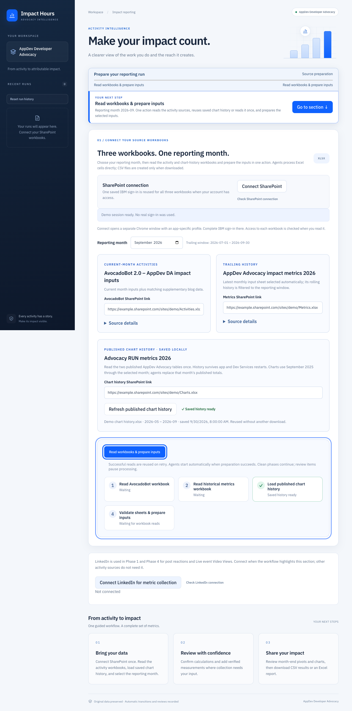
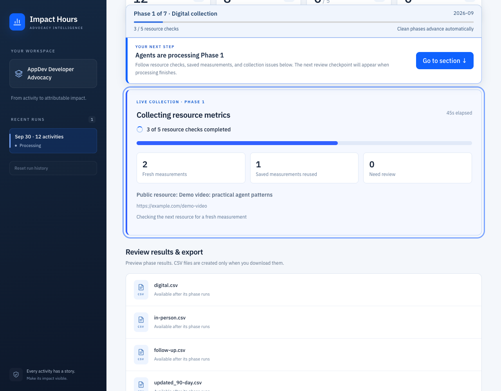
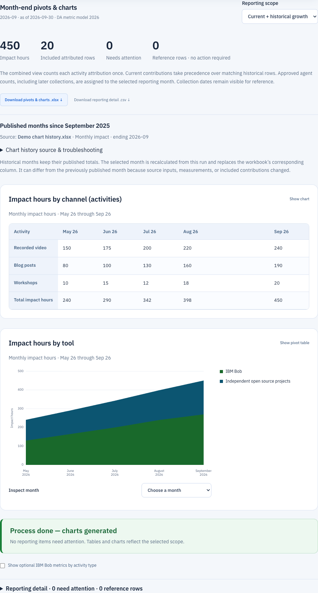

# Impact Hours AppDev

[**Operations guide →**](https://danieloh30.github.io/impact-metrics-appdev/) · [Local setup](docs/site/run/local.md) · [OpenShift deployment](docs/site/deploy/openshift.md) · [Kubernetes deployment](docs/site/deploy/kubernetes.md)

The guide includes screenshots with fictional data, workflow and architecture diagrams, editable chart exports, and recovery instructions. It uses a separate slate/teal design for platform teams. Only `docs/site` is published; internal analysis, live workbook links and authentication files are excluded.

Once reporting and required publication finish, the sticky monitor offers **Download pivots & charts** and **Start another run**. A new run retains history. If the seven agent phases have finished but publication or reporting review remains, the monitor labels that specific action instead of announcing full completion.

The web UI identifies the application as **Impact Hours**. When charts are ready it shows **Process done — charts generated**, separately from final workbook publication. Reports with actionable exclusions are clearly marked **Provisional** before the charts, with **Review items needing attention** navigation. Saving a confirmed month-end value recalculates the totals and charts automatically. Charts show eligible contributions; excluded rows remain visible for review and are never silently added.

LinkedIn setup is highlighted before Phase 1 and before Phase 3 completion starts the path to Phase 4. When supported LinkedIn URLs exist, the UI requires a saved connection or an explicit **Continue without LinkedIn** choice before starting/advancing collection. Publication previews remain available; publishing into Phase 4 waits for that choice. A visible **LinkedIn source check** timeline step and a zero-URL explanation avoid implying that sign-in can collect links missing from the inputs.

Published tool comparisons offer **Inspect TOOL contributors**. This opens included activities with an exact tool filter, source sheet/resource links, and their counted impact. Tool totals remain sums of eligible activity contributions and reconcile to the report total. Published summaries can differ because measurements, history windows and included activities differ; source assignments are not guessed from an old aggregate.


Monthly RH/IBM Sales User Experiences workshops use their supplied completed monthly totals directly. Duration is not multiplied again; ordinary workshops still use attendees × duration. Authors × tools are allocated once. For example, the September workshop inputs reconcile to 12,020 impact hours (Luxottica 1,500 + RH 7,530 + IBM 2,990), rather than 33,060. `MonthlyWorkshopAttendance.ACTIVITIES` defines the two confirmed rollup identities; this is not a general exception for every workshop. Saved reports, chart pivots, current exports and publication previews correct these two activities from immutable current input data on copies. Historical attributed rows are not reallocated, original phase versions are kept, and no SharePoint changes are made until a new publication is reviewed and confirmed.

Expand **Compare YYYY-MM with published totals** beside the charts to inspect published/recalculated impact and differences by activity and tool. The selected month is recomputed; the imported published totals are a comparison, while earlier months retain published values. Later online measurements and changed eligibility can produce valid differences. Publication stores reviewed values in owned numeric metric cells, replacing any old formula in those cells so recalculating Excel cannot restore obsolete counts. Custom formulas, unmatched rows and other sheets are preserved.


Quarkus LangChain4j application and React SPA for all seven RUN metrics phases. Read two SharePoint workbooks, select a reporting month, review unresolved items, enter verified measurements, preview results, and download CSVs or a ZIP. Workbook cells feed specialized agents and Java decimal calculations directly. CSV files are generated in memory only when downloaded; no intermediate CSV files are created. No IBM Bob or Python execution is required.

## See the workflow

New SharePoint runs pause after Phase 3 at **Publish current inputs before trailing collection**. **Preview workbook update** reads the live AppDev metrics workbook and shows updates, additions, unchanged baseline rows, skipped unresolved contributions, and whether a monthly tab will be created. Review and confirm, then **Publish current inputs & start trailing collection**. `MonthlyPublicationAgent` writes exact structured results directly through the saved SharePoint session; CSV files and PostgreSQL are not needed. It updates matching activity/date/author/tool/type/event/resource identities, appends new rows, and preserves unmatched rows, custom columns, unrelated sheets and original run baselines. New tabs use a year-qualified name such as `October 2026 inputs`. No existing rows are deleted.

Before/after workbook copies, reviewed digests and receipts live under ignored `runtimes/runs/<id>/publication/`. A live-content hash and SharePoint checkout protect concurrent edits; a successful upload must be read back and checked in before Phase 4 starts. Changed files, active editing locks, denied permissions and unavailable authentication keep the checkpoint retryable. This uses [Microsoft's file update and checkout/check-in APIs](https://learn.microsoft.com/en-us/sharepoint/dev/sp-add-ins/working-with-folders-and-files-with-rest) and [ResourcePath addressing](https://learn.microsoft.com/en-us/sharepoint/dev/solution-guidance/supporting-and-in-file-and-folder-with-the-resourcepath-api). The application requires your account to have edit access and does not change SharePoint permissions.

After processing, publish the **Completed monthly snapshot** from the same panel. Exact cumulative totals remain separate from monthly deltas and rounded CSV views. `Starting baseline` protects reruns of the same month; later months use the completed snapshot's latest `Current total`. Pre-trailing snapshots are marked `CURRENT_INPUTS` and cannot serve as a completed later-month baseline. Original imported baseline rows and workbook bytes remain immutable. Existing saved runs retain their audit history; clean checkpoints resumed in the UI can opt into automatic progression. Completed SharePoint runs can use direct publication. Reporting corrections invalidate an earlier completed publication; chart-history refresh alone does not.

The SPA shows **All processes are complete** when the required workbook publication, reporting review and historical charts are ready. **Start another run** opens fresh input setup without resetting history, retaining the previous month and URLs while fetching new source snapshots. You can repeat the same reporting month, change it, or change workbook URLs. Partial reporting and unavailable chart history are identified instead of announcing full completion.

Publication uses a padded responsive card with separate Preview, Confirm and Publish steps and spaced primary/secondary controls. Authentication/access-refresh errors highlight reconnect; stale previews highlight a fresh preview. Binary workbook reads use the SharePoint file API before opening an Excel viewer. If opening a direct Excel link starts a download or the viewer navigation times out, access is verified with file requests before reporting failure.

**Fix an ambiguous existing activity attribution:** the publication error identifies the monthly sheet, matching Excel row numbers, author and tool. Open the AppDev metrics workbook, compare the listed rows, and remove only confirmed accidental duplicate copies. Keep one row for each activity/date/author/tool/event/type/resource attribution; different author/tool splits are valid. If the rows have meaningful differences, correct their identifying fields instead of deleting a valid activity. With AutoSave enabled, wait until Excel shows **Saved**, then click **Preview workbook update** again. The app reads the latest workbook; no dev-mode restart or history reset is needed. The failed preview publishes nothing and the app does not automatically delete duplicates. For example, an activity split across IBM Runtimes and IBM Bob should have two rows, one per tool; two identical copies of each tool row should be reduced to those two valid rows. The SPA shows these repair steps instead of suggesting a network retry for this data conflict.

**Check a repeated publication failure:** **Check workbook status** performs a read-only `GET /api/runs/{id}/publication/status` using the saved SharePoint session. It reports the time checked, checkout state, any named lock/checkout owner, version and modification time. No named owner does not guarantee that a shared or transient conflict is absent. The panel labels the previous attempt **Last publication failed**; it is persisted server state, not a live lock indicator or Chrome page cache. A successful fresh preview clears the prior run error. Upstream failures retain the failed operation, HTTP status, sanitized SharePoint error details and Request ID when available; HTTP 409 is not automatically labeled an editing lock. Status checks do not change the workbook, release locks, approve a plan or start trailing collection.

**Fix a changed/locked workbook:** wait until Excel shows **Saved** (AutoSave), then close Excel editing tabs and desktop Excel sessions for the AppDev metrics workbook before publishing. If another editor owns the session, wait for them to finish and for the lock to release. Preview the latest workbook again, review it, confirm, and publish. The SPA shows these steps for a stale-preview/editing-lock failure, including failures returned by the background publication worker. Reading and publishing reuse the saved SharePoint session; **Connect SharePoint for publishing** is needed only when that sign-in expires or reconnection is requested. Reconnecting does not release editing locks. The app does not force-unlock a workbook or start trailing collection until publication is verified.

Explicit **Go to section** navigation stops any guided scroll animation and transfers keyboard focus to the action immediately, with a guarded handoff after the click. Dialogs and user-entered fields keep focus. Background guidance remains animated when motion is allowed. Failed browser CI runs retain traces and error context as the **browser-failure-diagnostics** artifact for seven days.

Publication endpoints: `POST /api/runs/{id}/publication/preview` accepts `version` and reporting `revision`; `POST /api/runs/{id}/publication` requires the reviewed `digest`, current version/revision and `confirmed: true`. Successful publication runs asynchronously with persisted progress and a receipt. No workbook is written merely by opening the panel or requesting a preview.

LinkedIn sign-in is highlighted **before Phase 1** when current inputs contain supported LinkedIn links, and **before publishing/Phase 4** when trailing inputs contain them. The saved session is reused. An explicit **Continue without LinkedIn** choice keeps manual review available; no sign-in, acknowledgement, collection retry, or publication is triggered automatically. Saved runs acquire the source counts when loaded. Runs with no supported LinkedIn source links keep normal phase guidance.

LinkedIn sign-in progress is checked automatically even before processing starts or when another phase is active. A waiting indicator shows elapsed time and sign-in instructions; after authentication it changes to a green session-saved message and re-enables connection controls. Reloading the SPA recovers an ongoing connection from the server. Status-check failures are shown with automatic retry; the server's existing five-minute sign-in timeout remains authoritative.

Reporting detail opens with **Needs attention**, keeping informational rows out of the action queue. **Already counted** uses a bold blue badge for a contribution included elsewhere; **No verified growth** uses a neutral badge when historical values were retained without a fresh measurement. This does not imply the content had no new views. **Not trailing-eligible** identifies one-time activities. Reference rows add zero extra impact and require no confirmation; use **Reference only** or **All rows** to inspect them. Summary counts distinguish attention from reference rows, and a clear confirmation appears when no reporting actions remain. These display changes do not alter calculations or exports.

When Phase 1 (digital collection) or Phase 4 (trailing 90 days) has unresolved LinkedIn reactions or Video Views, the next-action guide highlights the LinkedIn connection section. Complete sign-in there; the SPA checks the session automatically and then focuses the collection retry button. Successful measurements stay saved. Required numeric corrections take priority, and manual entry or explicit follow-up acknowledgment remain available. No sign-in or retry is triggered by focusing the button.

The screenshots below use representative sample data to illustrate the interface.

### 1. Connect your SharePoint workbooks

Choose a reporting month, connect once, and read the activity workbooks and load saved chart history with one action. Source details and progress make each step easy to follow.



### 2. Review what the agents changed

Clean phases advance automatically. Checkpoints highlight only unresolved collection or data review and required workbook publication; all automatic transitions and human reviews are recorded.



### 3. Search your results and export

Filter preview rows by author, tool, activity, or other cell text across every page. Download individual CSV files or the complete ZIP when the run is ready.



## Deploy a persistent workspace

The [Quarkus OpenShift extension](https://quarkus.io/guides/deploying-to-openshift-docker-howto/) generates OpenShift and Kubernetes resources. The `openshift` profile uses an in-cluster Docker build with Java 25, Chromium and a private sign-in desktop. One StatefulSet replica mounts the `impact-hours-data` PVC so run history, sign-in sessions and chart history survive replacement. The image supports arbitrary non-root OpenShift UIDs and a read-only root filesystem. No public Route is created.

```bash
# Build and validate manifests locally; no cluster changes.
./deploy-openshift.sh --generate

# After oc login, create storage, build the image and deploy.
./deploy-openshift.sh --deploy --namespace impact-metrics

# Private UI and sign-in desktop on localhost, using oc authentication.
./deploy-openshift.sh --connect --namespace impact-metrics
```

Open `http://127.0.0.1:8097` for the app and `http://127.0.0.1:6080/vnc.html` for interactive SharePoint/LinkedIn sign-in. The desktop service binds pod loopback and is not exposed by a Service. The supplied ingress NetworkPolicy blocks network access to the workspace; the approved `oc port-forward` tunnel remains available. Each instance represents one reporting workspace, not a multi-user service. See the [OpenShift guide](docs/site/deploy/openshift.md) for prerequisites, storage and recovery, or the [Kubernetes guide](docs/site/deploy/kubernetes.md) for external image builds and cluster-specific volume permissions.

Deployment verification includes generated-manifest checks, mocked CLI regression tests, and a local container smoke test covering arbitrary UID, read-only root, HTTP serving and headed/headless Chromium. A live cluster deployment is a separate operation.

To build the documentation locally:

```bash
python3 -m venv .venv-docs
.venv-docs/bin/python -m pip install -r requirements-docs.txt
.venv-docs/bin/python -m mkdocs build --strict
node scripts/check-docs.mjs
```

## Start locally

Requires Java 25+, Node 20.19+ or 22.12+, and npm. The Maven wrapper is included. On this Mac, `dev.sh` finds the installed SDKMAN/Homebrew JDK when system Java is not configured. Select a Java 25+ installation.

```bash
cd /Users/danieloh/developer-advocacy/tools/impact-metrics-appdev
./dev.sh
```

Open **http://127.0.0.1:8097**. Quinoa builds and serves the SPA through Quarkus; no separate frontend server is needed. First startup requires dependency downloads. Override the port with `./dev.sh -Dquarkus.http.port=8098` if necessary.

Connect SharePoint once with your IBM account and choose the reporting month, then select **Read workbooks & prepare inputs**. Both editable URL fields start with the supplied defaults. The app reads both sources and prepares their selected sheets sequentially. Ambiguous selections pause for review. If a step fails, **Retry failed step** reuses successful snapshots; independent re-read controls are available under each workbook’s **Source details**. Prepared inputs start processing automatically; clean phases advance without an approval checkbox or button. Required data reviews, LinkedIn setup choices and workbook publication remain explicit checkpoints. CSV/local Excel import controls and runtime seed import endpoints are removed. Download results individually or as ZIP.

Restarted/interrupted runs become retryable and resume from immutable phase inputs. Successful measurements are cached per run. Approvals reference exact artifact versions; edits generate fresh versions.

## Workbook-first agent processing

The app's `runtimes/RUN.md` and `runtimes/AGENTS.md` now describe the Quarkus workbook workflow rather than Python scripts or Bob commands. Existing runs keep their frozen instructions; create a new run to use the updated rules.

WorkbookPreparationAgent reads Excel cells directly into structured row data. That data feeds all phase agents without serializing and reparsing CSV. A comma in a name/title is ordinary text; Excel cell boundaries define columns. Semicolons and line breaks inside Author/Tool cells explicitly separate multiple values for attribution. A numeric cell uses its stored value, including the saved result of a formula, rather than a formatted `1,000`, currency, or percentage display. Dates retain their source date/month handling. Input CSV snapshots are generated only on demand from immutable source data, and older saved runs remain readable.

For a **current-month digital activity without a URL**, valid nonnegative `Views / attendance` and numeric `Duration (in hours)` let it proceed into `digital.csv` without a manual collection warning. Supplied view counts remain views; only in-person rows multiply attendance by the minimum-one-hour duration. Zero views is valid. Missing values still require collection; invalid supplied values require correction. This rule does not bypass a URL's provider collection or replace the fresh lifetime totals needed for trailing deltas.

## Two SharePoint workbook inputs

The preparation agent uses the existing [Quarkus Apache POI extension](https://docs.quarkiverse.io/quarkus-poi/dev/index.html). Each workbook is read separately and held as a snapshot; changing the reporting month reuses those snapshots.

| Source | Default link and use |
|---|---|
| Current activities | [AvocadoBot 2.0 – AppDev DA impact inputs](https://ibm.sharepoint.com/:x:/r/sites/DEPT-DeveloperRelations/Shared%20Documents/Really%20Useful%20Numbers%20(RUN)/Advocacy/2026/Input%20files/AvocadoBot%202.0%20-%C2%A0AppDev%20DA%20impact%20inputs.xlsx?d=w25cb891e867b4fb39d1b486b41c9ce5b&csf=1&web=1&e=pge2wn): selected current sheet plus reporting-month Markus/Elder blog rows |
| Trailing history | [AppDev Advocacy impact metrics 2026](https://ibm.sharepoint.com/:x:/r/sites/DEPT-DeveloperRelations/Shared%20Documents/Really%20Useful%20Numbers%20(RUN)/Advocacy/2026/Working%20data/AppDev%20Advocacy%20impact%20metrics%202026.xlsx?d=w17d51aa602214ef29e2d761379e0b65f&csf=1&web=1&e=BdC23f): month-named sheets such as August inputs and September inputs |

Monthly input sheets already contain rolling history. Choose **one latest monthly input sheet** at or before the selected reporting month, within its three-month window, then filter activity dates. For October 2026, use October inputs when present, or September inputs when October is absent, and include only August 1–October 31 dates. For September, use September inputs and July 1–September 30 dates. Do not combine August/September snapshots: their activities overlap and their baselines reflect different reporting periods. The selected baseline sheet and fallback are visible in the SPA. Missing dated months are highlighted; unavailable data is never invented. Matching hidden, invalid, or ambiguous latest sheets block preparation. The server derives the same choice from the month. Explicit years in sheet names are respected; date filtering always constrains the year. Other workbook sheets and AvocadoBot's previous-month sheets never supply history.

Historical Current total values remain the previous baselines. Missing, negative, or invalid baselines require Phase 4 review only for rows calculating a delta; fresh totals never substitute for historical measurements. Author × tool splits conserve recorded totals. Each prepared row records its source workbook/sheet. This is a three-calendar-month window, not exactly 90 elapsed days.

The workbook requires `Date of activity` (or `Date`), `Author of activity` (or `Author`), `Type of activity`, and `Link / URL to resource` headers in the first 30 rows of each selected sheet. Header matching ignores case, repeated whitespace, line breaks, and nonbreaking spaces. The raw workbook header **Link / URL to public resource** maps to **Link / URL to resource**; scoped headers such as **Author of activity (Java Runtime)** and **Tool (Java Runtime)** map to **Author of activity** and **Tool**. Content/deck and trip-report links stay separate and are not substituted for a missing public URL. Extra named columns are retained. Excel dates, ISO dates, and US M/D/YYYY dates are supported. Formula cells use saved cached values; recalculate and save in Excel first. The application never evaluates formulas, macros, or external links. Hidden sheets are excluded. Invalid dates, duplicate headers after normalization, Excel errors, and data without headers are rejected with a readable message. Limits: 100 sheets, 20,000 rows per sheet, and 100 columns.

The two blog sheets supplement the current input automatically from the AvocadoBot SharePoint snapshot. **Markus blog data** is filtered by `Date`; **Elder blog data** is filtered by `Month`. The UI shows each sheet's matching count when you change the reporting month. Their source-specific columns map as follows:

| Blog source column | Generated activity column |
|---|---|
| `Date` / `Month` | `Date of activity` |
| `Name` | `Author of activity` |
| `Title` | `Name of activity` |
| `Link` / `blog` | `Link / URL to resource` |
| `Views` / `views` | `Views / attendance` |
| `Type` | `Type of activity`; blank values default to `Blog post / slide shares / .io updates` |
| `Current`, `Previous`, `Trailing` | `Current total`, `Previous total`, `Trailing 90-day` |

Tool, author, title, URL, saved view counts, and other source values are preserved. Supported month values include Excel dates, ISO/US dates, `2026-09`, `Sep 2026`, and `September 2026`. A month-only value uses its first day for grouping and records `Source date precision = Month only`; it does not claim an exact publication day. Every appended row records `Source sheet` and `Source row`. Rows with blank Date/Month are excluded and counted in a visible warning; fill their month in Excel and read the workbook again to include them. Invalid nonblank dates or malformed visible blog sheets produce a validation error. Hidden blog sheets remain excluded. No dates, URLs, authors, or view counts are invented. Blog supplements are not offered as primary/history sheets, preventing accidental double import; they append to the current input only. Their per-sheet appended and undated counts are saved in run state as `blogRows` and `blogSkippedRows`, and shown under **Prepared workbook inputs**. A month can be prepared from matching blog rows even when the selected primary sheet has no rows for that month. Historical inputs come exclusively from the separate metrics workbook; baseline review rules remain unchanged.

If historical sheets contain only raw submissions without processed `Current total` values, the app can generate the trailing input, but those activities require verified baseline entry during phase 4. Fresh scraped totals cannot reconstruct historical totals. No trailing dataset is prepared when no activities qualify; no input CSV is created unless downloaded.

Both optional input CSV snapshots use UTF-8 and are generated in memory when downloaded from **Prepared workbook inputs**; preparation does not create CSV files. Both original workbooks are preserved as `rawdata/original.xlsx` and `rawdata/trailing-original.xlsx` under their run; filenames, sheet choices, reporting month, date window, SHA-256, and missing-baseline count are recorded in run state. All workbook data remains inside ignored `runtimes/runs/` storage.

Inspection includes `suggestedCurrentSheet` and `suggestedHistorySheets`; the SPA uses these recommendations for SharePoint imports. Excluded sheets report the missing activity-header structure or hidden status. A sheet row count describes all dated rows before the reporting-month/window filters.

## SharePoint connection and snapshots

The shared **Connect SharePoint** control normally opens AvocadoBot in a separate local Chrome window with an app-specific profile. Complete IBM SSO/MFA. Saved browser cookies/storage are reused for both `ibm-my.sharepoint.com` and `ibm.sharepoint.com`; the workbook read redeems its original link if site access needs refreshing. A single sign-in is sufficient when IBM SSO and both workbook permissions allow it. If the second site requires interactive sign-in, a failed read shows a reconnect message and Connect opens that workbook. Your account still needs download access to each file. Other hosts, credentials in URLs, traversal paths, non-HTTPS and non-XLSX files are rejected.

Each read has its own progress, error, and ready state; failure or link editing invalidates only that workbook's snapshot. Preparation requires both valid independent snapshots. The cache holds five snapshots for 30 minutes; consumed/expired tokens return HTTP 410 and require rereading. Original bytes are stored as `rawdata/original.xlsx` and `rawdata/trailing-original.xlsx` with separate filenames, canonical source URLs without sharing queries, and SHA-256 hashes. All private data stays in ignored runtimes storage. CSVs are generated only for requested downloads.

The indeterminate progress UI shows actual download/validation/sheet-inspection stages and elapsed time. It does not invent a percentage. HTTP 401 requires reconnecting; HTTP 403, missing files, invalid workbooks and timeouts have specific errors. Chrome is required locally; `METRICS_SHAREPOINT_BROWSER_CHANNEL`, `METRICS_SHAREPOINT_BROWSER_EXECUTABLE`, and `METRICS_SHAREPOINT_ENABLED` configure the integration. Reset preserves saved sessions. Passwords/cookies are never sent to model agents.

Endpoints: `GET/POST /api/sharepoint/session`; `POST /api/workbooks/from-sharepoint` with JSON `url`; `POST /api/runs/from-sharepoint` with multipart `sourceToken`, `historySourceToken`, `month` and `currentSheet`. Historical sheet selection is server-derived. `GET /api/runs` lists saved runs; POST CSV import, `/api/runs/from-runtimes`, `/api/runs/from-workbook`, and `/api/workbooks/inspect` have been removed. Input/result download endpoints remain available, including audit snapshots named AvocadoBot 2.csv and trailing_90-day.csv. Existing runs preserve their frozen instructions; create a new run for the two-source contract.

References: [SharePoint authentication](https://learn.microsoft.com/en-us/sharepoint/authentication), [Playwright authentication state](https://playwright.dev/java/docs/auth), [authenticated HTTP requests](https://playwright.dev/java/docs/api/class-apirequestcontext).

## Web interface


The **AppDev Developer Advocacy** workspace uses self-hosted IBM Plex Sans, a navy sidebar, blue action controls, and responsive cards for imports, run summaries, collection review, and exports. The mobile layout keeps workspace identity and recent runs accessible. Keyboard focus indicators, a skip link, and reduced-motion support are included; fonts load locally without third-party requests.

## Source structure

Backend packages under `src/main/java/com/ibm/advocacy` separate responsibilities:

```text
agentic/   # individual phase agents, sequence workflow, and model reviewers
model/     # row/run data, measurements, approvals, artifacts, and CSV schema
resource/  # REST endpoints and API error mapping
service/   # durable run orchestration, seven-phase pipeline, decimal calculations
collector/ # public metrics providers and authenticated LinkedIn collection
csv/       # CSV parsing, encoding, and serialization
storage/   # runtimes boundary and atomic state/file persistence
```

`src/test/java/com/ibm/advocacy/service` contains calculation and workflow integration tests. The React SPA remains in `src/main/webui`, with Quarkus configuration in `src/main/resources`. Package refactoring preserves REST paths, CSV formats, and persisted run JSON; runtime data stays in `runtimes`.

## Runtime storage

All production raw data and outputs stay under `runtimes`. The SharePoint workflow no longer uses root-level seed CSVs; resetting history removes the two obsolete inputs. The app never processes the original project's `ai` or `devops` folders.

```text
runtimes/
  RUN.md
  AGENTS.md
  runs/<run-id>/
    rawdata/           # original.xlsx + trailing-original.xlsx; older saved CSV uploads
    instructions/     # frozen instruction snapshots
    state/            # atomic state, measurements, approvals, row lineage
    output/<version>/ # immutable JSON result datasets, e.g. digital.json
  .sessions/          # optional LinkedIn browser profile
  .uploads/           # temporary multipart uploads
```

Git excludes runtime CSVs, every file under `runtimes/runs/`, sessions, uploads, and future rawdata/output folders. Only `runtimes/RUN.md` and `runtimes/AGENTS.md` are versioned.

Filesystem access rejects traversal and symlink escapes. Current input and workbook-generated inputs are UTF-8; separately uploaded legacy trailing CSVs are Windows-1252; exports are UTF-8. Structured phase datasets retain source columns and row IDs. `current.csv` uses the exact 24-column RUN schema.

The contract fixes the legacy script gaps: unresolved digital rows are exclusively follow-up; attribution divides by authors × tools and conserves totals at six decimals; in-person Views / attendance contains allocated attendance hours; trailing totals preserve previous baselines, allocate shared URL totals once, and calculate deltas. Negative deltas remain visible. Phase-5 and unknown activity types are retained. Booth-lead collection and later follow-up recalculation require a separate request.

RUN.md and AGENTS.md must match the reviewed instruction SHA-256 in `metrics.instructions.sha256`. If instructions change, review and implement the new rules before updating that hash. Each run freezes its own copies.

## Agents and optional model review

`agentic.PhaseWorkflow` is a LangChain4j sequence of InstructionAgent, DigitalMetricsAgent, AttendanceAgent, AttributionAgent, Trailing90Agent, ExportAgent, and ValidationAgent, with isolated AgenticScope IDs. Durable Java orchestration enforces approvals and recovery.

Phase readiness and background-worker release happen under the same run lock. A phase shown as awaiting approval can immediately accept approval; the finishing worker cannot clear the next worker's busy state. A repeated seven-phase regression exercises immediate approvals without delays or busy retries.

Plain Java agents perform exact calculations and I/O. Optional InstructionReviewer and QualityReviewer model agents explain bounded contract/phase summaries. Models cannot invent measurements or approve phases. The complete workflow runs without model credentials; commentary is disabled by default.

To enable commentary before starting, set `METRICS_AI_ENABLED=true`, `METRICS_MODEL_API_KEY`, `METRICS_MODEL_BASE_URL`, and `METRICS_MODEL_NAME`. The configured endpoint must support the OpenAI-compatible chat API. Frozen instructions and bounded issue summaries are sent to it; full CSVs and personal columns are not sent. Model failures preserve deterministic processing.

## Collection and LinkedIn

Public collectors support DZone article Views, YouTube viewCount, GitHub repository stars, and Terraform Registry provider downloads, with fixed hosts, private-address checks, bounded redirects, timeouts, and response-size limits. Unsupported sites and provider/rate-limit failures create manual tasks. Evidence and collection timestamps are saved.

For LinkedIn, run `npx playwright install chromium` from `src/main/webui`, then choose **Connect LinkedIn** and sign in to the dedicated browser window. Use **Check connection**, then **Retry unresolved collection** at the current review. Set `METRICS_LINKEDIN_ENABLED=false` to disable browser collection.

Posts/feed/pulse use total reactions only. Events follow the admin post-analytics link and require **Video Views** from Video performance. Lifetime unique viewers and peak concurrent viewers are not accepted substitutes. Missing login/admin access or changed markup falls back to manual entry. Authenticated LinkedIn collection and live LLM responses have not been verified in this session.

## Automatic processing and live status

Workbook preparation starts the agents automatically; the calculation rules remain available for reference. LinkedIn URLs require a saved connection or an explicit choice to continue without it. Clean phases advance on the backend, even if UI polling is delayed. A correction that resolves all issues resumes the automatic path; remaining optional issues still need acknowledgment. Automatic phase transitions have `automatic: true` in the approval audit. The existing `/api/runs/{id}/start` and `/phases/{phase}/approve` endpoints accept an optional `automaticProcessing` boolean; old API callers retain their manual workflow when omitted. The persisted run flag survives restarts, and interrupted work still requires an explicit retry.

The sticky process monitor shows completed agent phases, real resource-check counts, review pauses, publication, chart generation, and **Process done**. The phase bar measures agent work; it does not claim the entire workflow is done while reporting attention or publication remains. SharePoint preview, confirmation and final publication remain explicit actions. No new dependency or endpoint is introduced.

## Reset run history

Saved runs persist across dev-mode restarts in `runtimes/runs/`; this application stores history in files rather than PostgreSQL. Choose **Reset run history** in the sidebar and confirm **Delete all run history** to clear every saved run, its uploaded copies, measurements, approvals, and output versions. The SPA then clears the selected run, previews, counters, and browser's remembered run ID.

Reset also removes the obsolete `runtimes/AvocadoBot 2.csv` and `runtimes/trailing_90-day.csv`, even when there are no saved runs. It keeps `RUN.md`, `AGENTS.md`, `.sessions/` for SharePoint/LinkedIn authentication, `.chart-history/` for published chart tables, and unrelated files directly under runtimes. The dialog names both obsolete files before confirmation. Only those two root-level filenames are removed; symbolic links are unlinked without deleting their targets, and unexpected directories at those names are rejected before history is erased. Download any results you want to retain first. Reset is rejected while a run is actively processing; wait for completion or cancel and wait for cancellation to finish. Filesystem deletion does not follow symlinks. History is not automatically erased on startup. Connected live streams receive a final `RESET` event and close when their run is deleted; the SPA clears the stale selection in other open tabs as well.

API: `POST /api/runs/reset` with JSON `{"confirm":true}` returns `{"deletedRuns":N}`. Missing confirmation returns 400; active processing returns 409. Imports and run actions are serialized against reset.

Browser workflow tests should use a separate runtime root ending in `runtimes` to keep synthetic runs out of the working history.

## Measurement popup input values

The measurement popup loads saved row context for URL and no-URL rows in phases 1, 2, and 4, including existing saved runs. It displays original Views / attendance, Duration (in hours), and the baseline separately, and prefills the editable total using the metric being reviewed. A blog view input of `1000` starts at `1000`; a zero starts at `0`. Baseline corrections use Current total, duration corrections use Duration, and reactions use the supplied reactions when available. The latest manually saved measurement overrides the editable prefill without overwriting displayed originals. Numeric grouping in legacy values is normalized for the numeric field.

**Source / collection note (optional)** can be left blank. No note is fabricated: the run records “source / collection note not provided.” Saving still requires a valid nonnegative number, the right metric type, and the current phase/version. In trailing review, confirm or edit the prefilled value before treating it as a fresh measured total; the immutable original and baseline remain visible for comparison. URL rows keep the existing fresh-total/delta workflow and do not get the no-URL retention action.

Endpoint: `GET /api/runs/{id}/measurement-input?rowId=...&type=...` returns immutable originals and the metric-specific editable prefill. The existing measurement POST accepts an omitted/blank `evidence` note.

## Review original trailing input values

Historical rows without a URL and with valid nonnegative supplied views now pass automatically; no collection, baseline, or duration review is required. For an unresolved historical row without a URL, choose its **Enter views** (or baseline correction) action to open **Review original input**. The app reads original values from the saved historical row, including runs imported before this feature. The dialog shows original Views / attendance, Duration (in hours), and the recorded previous baseline. Its editable attendance and duration fields are prefilled from the original row or the last saved input review.

- **Keep original values** records an explicit review without changing the source values or requiring a collection note.
- **Save edited inputs & refresh review** saves nonnegative numeric attendance and duration; a review note is optional. Original source data remains unchanged.
- **Enter a fresh total instead** switches to the existing verified-measurement form. Its total starts with the recorded previous total, or the latest saved measurement, in attributed row units.

After keeping/editing, collection and baseline issues for that row clear. Processing continues automatically when no review items remain; otherwise review the remaining issues. Baselines are required for actual trailing deltas, not for this explicit decision to retain input data without computing a delta. Missing input values cannot be kept until valid numbers are entered. Saved decisions survive refresh/restart, require the current review version, and are limited to no-URL rows in phase 4.

`updated_90-day.csv` preserves `Original Views / attendance` and `Original Duration (in hours)` for all rows. Reviewed no-URL rows write the retained/edited values and duration, preserve the recorded total, and carry `Metric basis = Retained input — not a trailing delta` or `Reviewed input — not a trailing delta`. Unresolved rows keep their originals in the extra columns without inventing a delta. This makes completing review without updating values explicit and auditable.

Endpoints: `GET /api/runs/{id}/trailing-input?rowId=...` returns original/effective input values; `POST /api/runs/{id}/trailing-inputs` accepts `version`, `rowId`, `keepOriginal`, optional `views`/`duration`, and optional `note`, and regenerates the review artifacts.

## Collection & data review

A row appears in **Collection & data review** when the backend adds an entry to `run.issues`. The SPA displays the section whenever that list is nonempty. These are deterministic Java rules; model agents do not decide whether a row needs manual review.

| Condition | Review category | Approval behavior |
|---|---|---|
| Current digital row: no URL but valid supplied Views / attendance and Duration (in hours) | No collection issue | Proceeds using input metrics |
| Current digital row: no URL and missing Views / attendance or Duration (in hours); or trailing row: no URL and missing/invalid supplied views | Manual collection | Enter a verified measurement or acknowledge follow-up |
| Historical row: no URL and valid supplied Views / attendance (including zero) | No collection issue | Retains supplied views; no baseline/duration or fresh delta required |
| During URL collection: unsupported website (except the configured blog/digital exclusions below), malformed URL, failed request, or unavailable metric | Manual collection | Enter a verified measurement, retry, or acknowledge unresolved collection |
| LinkedIn login/admin access unavailable, or reactions/Video Views cannot be extracted | Manual collection | Enter a verified measurement, retry, or acknowledge unresolved collection |
| Supplied current no-URL digital metrics are invalid or views are negative | Correction required | Must correct before approval |
| In-person attendance is blank, nonnumeric, or negative | Correction required | Must correct before approval |
| Duration is supplied but nonnumeric | Correction required | Must correct before approval |
| Trailing baseline is blank, nonnumeric, or negative for a row calculating a delta (automatically supplied or explicitly retained/reviewed no-URL inputs are exempt) | Correction required | Must correct before approval |

Missing in-person duration defaults to one hour. Manual entries require a nonnegative numeric value and the expected metric type. Source / collection notes are optional (maximum 1,000 characters); omitted notes are recorded as not provided. Entering a measurement regenerates the phase artifacts and creates a new version; automatic runs continue when all review items are resolved. Collection issues are scoped to the current phase; trailing collection reports one collection issue per shared URL group.

Currently, booth duty and other/unknown activity types go into `follow-up.csv` without appearing in this review section. Negative trailing deltas receive a CSV review note but do not create a review-panel issue.

Implementation: [review panel](src/main/webui/src/main.tsx), [phase issue rules](src/main/java/com/ibm/advocacy/service/Pipeline.java), [provider collection failures](src/main/java/com/ibm/advocacy/collector/MetricCollectors.java), [LinkedIn collection](src/main/java/com/ibm/advocacy/collector/LinkedInCollector.java), and [approval/manual-entry validation](src/main/java/com/ibm/advocacy/service/RunService.java).

## Verification

Validation passed: **127 Java tests**, the TypeScript/Vite build, and **46 browser checks**. Automated verification covers the two-workbook SharePoint flow with synthetic transport, month-named sheet selection, date/year cutoffs, source isolation, snapshot reuse/expiry, both source hashes and immutable bytes, removed import endpoints, and the seven-phase workflow. Browser regressions cover one connection control, independent reads/errors, both default URLs, changing the reporting month without rereading, download progress, blog counts, missing-sheet warnings, preserved review/approval behavior, and mobile layout. Real-Chrome tests use synthetic cookies and loopback HTTP responses to check saved authentication and downloads without contacting IBM. A live read of AppDev Advocacy impact metrics 2026 succeeded with the saved session on both IBM hosts; its August and September input sheets were eligible. Live access still depends on IBM permissions and sign-in policy.

Java tests mirror the service package in `src/test/java/com/ibm/advocacy/service`. Use Quarkus Dev UI/MCP testing, or `./mvnw test` in CI. For browser tests, start an isolated server from the project root in a separate terminal:

```bash
mkdir -p /tmp/impact-metrics-e2e/runtimes
cp runtimes/RUN.md runtimes/AGENTS.md /tmp/impact-metrics-e2e/runtimes/
./dev.sh -Dquarkus.http.port=8098 \
  -Dmetrics.runtime-root=/tmp/impact-metrics-e2e/runtimes \
  -Dmetrics.collection.enabled=false
```

Then run the browser suite in another terminal:

```bash
cd src/main/webui
npm ci
npx playwright install chromium
METRICS_URL=http://127.0.0.1:8098 METRICS_RESET_TESTS=true npm run test:e2e
```

`METRICS_URL` overrides the test URL. `PLAYWRIGHT_CHROMIUM_EXECUTABLE_PATH` selects an existing compatible Chromium. Browser tests create synthetic runs in the isolated runtime directory. The destructive reset test is skipped unless `METRICS_RESET_TESTS=true`; use that flag only with a dedicated test runtime root.

## API and references

`GET /api/runs`: saved-run list; `POST /api/runs/from-sharepoint`: two-workbook snapshot import. Per-run endpoints provide state, start, phase approval, measurements, retry, cancel, SSE events, artifact list/preview/download, and download-all ZIP. `/api/linkedin/session` starts/checks authentication.

[Migration plan](docs/MIGRATION_PLAN.md) · [Source analysis](docs/SOURCE_ANALYSIS.md) · [Quarkus REST](https://quarkus.io/guides/rest) · [LangChain4j Agentic](https://docs.quarkiverse.io/quarkus-langchain4j/dev/agentic.html) · [Quinoa](https://docs.quarkiverse.io/quarkus-quinoa/dev/index.html).

The workbook-first pipeline update passes five additional Java regressions: structured sheet/row IDs without CSV reparse; stored/cached numeric values independent of currency, grouping, percentage and duration formatting; comma preservation and multiline attribution; complete no-URL metrics through all phases with conserved totals; missing/invalid inputs and correction; and protection against using current input evidence as a fresh trailing total. The two targeted workbook browser regressions also passed after this update.

Trailing input review passes four additional Java regressions covering original/effective value retrieval, legacy grouped-count prefill, keep/edit provenance and immutable originals, stale versions and resource scope, completion without invented lifetime totals/deltas, and explicit handling of missing inputs/baselines. The new mocked browser test passed for original numeric prefill, keep/edit requests, the separate fresh-total path, and mobile layout; TypeScript/Vite build passed.

Measurement-input prefill passes three additional Java tests for URL blog originals, latest manual values, metric-specific baseline/duration selection, optional or omitted notes, fresh trailing delta semantics, and existing row/type/length/numeric validation. Three browser regressions passed: current and trailing URL popups prefill 1000 and submit with a blank note, and the existing no-URL keep/edit workflow still works. TypeScript/Vite build passed.

## Structured processing and on-demand exports

Workbook preparation and all seven phases use structured `Data`/`Row` objects. Persisted sources, phase checkpoints, and immutable result versions are JSON; no input or phase CSV files are generated. `ResultStore` saves `output/<version>/<dataset>.json` and hashes those bytes for approval digests. Existing REST artifact names such as `digital.csv` identify the export format, not stored CSV files.

The SPA previews the selected JSON result version directly. Approvals, corrections, retries, and reload recovery use those structured datasets and immutable sources. CSV encoding/parsing is absent from the workbook agent pipeline. Explicit semicolon or line-break separation within Author/Tool cells remains an attribution rule; ordinary commas inside Excel text remain literal content.

Only a download request serializes CSV into memory: optional input snapshots, individual phase/final results, or all available results in a ZIP. Downloads create no files in the run folder. Export names, UTF-8 encoding, and the exact 24-column final schema remain compatible. Uploaded legacy CSV originals are preserved, and older saved CSV results/phase filenames remain readable without rewriting old runs. Reset still deletes all run-owned versions and uploads.

Endpoints remain unchanged. `GET /api/runs/{id}/artifacts/{name}/preview` reads structured rows, `.../download` exports that result version as CSV, `.../inputs/{name}/download` exports an immutable source snapshot, and `.../download-all` builds a ZIP in memory.

Verification for structured result storage: **66 Java tests passed**, including four new regressions covering all seven phases and historical keep/edit review without CSV files, immutable JSON versions and approval hashes, previews preserving sheet row IDs, on-demand input/result CSV and ZIP downloads with no disk changes, and compatibility with older CSV results and JSON phase filenames. TypeScript/Vite build and four mocked browser regressions passed, including the new structured preview/download flow and mobile layout. Phase 3 continues to create the full author × tool Cartesian product, allocate digital views or in-person attendance hours, and conserve totals; it stores structured results and keeps the existing CSV download names.

## Phase 2 attendance review

When Phase 2 publishes its in-person result, the SPA automatically selects `in-person.csv` for its structured preview, including after reload or recovery. Preview pagination resets to the first page on this transition. Polling and later versions preserve an explicitly selected different result; no CSV is generated by the preview.

Phase 2 approval remains required by RUN.md even when its issue count is zero. Zero issues means that the phase's collection/numeric validation passed; it does not verify the accuracy of submitted attendance, activity classification, or duplicates. The review panel now lists what to check: activity types and reporting-month dates, attendee counts, duration with the one-hour minimum, attendance-hours calculation, authors/tools before Phase 3 attribution, and booth duties retained in follow-up. An empty in-person result explicitly asks users to confirm that no eligible activities were submitted. Incorrect source values should be corrected in Excel and imported as a new run before approval. Existing blocking-issue and acknowledgment requirements remain enforced.

Every approval checkpoint now highlights **What changed from the previous phase** (or **since import** in Phase 1), including automatic classification, attendance calculation, attribution, and historical review changes. Phase 2/3 row-count comparisons use the previous phase's approved artifact version through the structured preview API, rather than assuming the immediately preceding version is the previous phase. If prior counts cannot be read, only current counts are shown with an availability note. Zero-issue phases explicitly state that no manual updates are flagged and explain why the user still confirms the automatic changes. The relevant result preview opens for each published phase: digital in Phases 1/3, in-person in Phase 2, historical in Phase 4, follow-up in Phase 5, and current in Phases 6/7. Manual preview choices remain intact during polling and reruns of the same phase. No approval gates or calculations were changed.

The **No manual updates flagged** status is emphasized with a bold, high-contrast green badge and a check-circle icon. It remains distinct from the amber issue-review status, is announced as a polite status update, and wraps within mobile layouts. This status does not replace the required approval or certify source-data accuracy.

The SPA includes a sticky **Your next step** guide for SharePoint connection, both workbook reads, preparation, calculation-contract acceptance, phase corrections/approval, retry, and final downloads. The active section and control receive a visible outline. **Go to section** scrolls to and focuses the relevant control; transitions automatically bring new checkpoints into view, while routine polling and same-phase versions preserve the user's position. Reduced-motion users get immediate scrolling. Text editing and open dialogs pause automatic navigation. Unresolved optional collection items offer a shortcut to the acknowledgment control without checking it automatically. Source inputs collapse after preparation and can be reopened for a new reporting run. Only unresolved issues and workbook publication require explicit review. Downloads remain explicit user actions.

### Blog and digital manual-check exclusions

Maintain the comma-separated `metrics.collection.manual-check-exclusions` list in `src/main/resources/application.properties` (or override `METRICS_COLLECTION_MANUAL_CHECK_EXCLUSIONS`). The defaults are:

| Entry | Matching scope |
|---|---|
| `eldermoraes.com` | Entire host |
| `www.the-main-thread.com` | Entire host |
| `ibm.admin.webcasts.com` | Entire host |
| `www.sigs.de` | Entire host |
| `www.heise.de` | Entire host |
| `www.infoq.com` | Entire host |
| `quarkus.io/blog` | `/blog` and its descendants only |
| `https://www.youtube.com/watch?v=OSsatFo8Pmc` | Only that watch video; extra tracking parameters allowed |
| `www.kevindubois.com` | Entire host |
| `thedevconf.com` | Entire host |
| `ec.yourlearning.ibm.com` | Entire host |
| `www.ibm.com` | Entire host |

Host matching ignores case and the optional `www` prefix; unrelated subdomains and lookalike hosts do not match. Path prefixes stop at a slash boundary, so `/blogger` is not covered by `/blog`. Query-specific rules require exact values and reject duplicate conflicting query values. Other YouTube videos still use normal collection.

Matching digital content uses the supplied workbook Views / attendance without URL collection or a manual-collection issue. Zero is valid; missing, invalid, or negative views still require a data correction. Duration is preserved and not required for digital views. Historical rows retain supplied views and prior totals, with **Workbook content input — not a trailing delta** provenance. No fresh lifetime measurement or delta is invented. Existing verified overrides remain supported as supplied content values; excluded historical content does not calculate a delta. The activities stay in results and author/tool attribution. Retry a previously published phase, or create a new run, to refresh its saved review issues under updated rules.

## One-action SharePoint preparation

After sign-in and reporting-month selection, **Read workbooks & prepare inputs** sequentially reads AvocadoBot, reads the separate historical metrics workbook, loads persistent chart history (or reads its workbook once), validates sheet selection, and prepares a new run. Four progress cards identify the active step, successful snapshots, and failures. Processing starts automatically after preparation and LinkedIn setup when needed. Clean phases advance in the backend without a separate approval button.

**Retry failed step** retains successful downloads and resumes at the missing read or preparation; it does not download both sources again. A second-site sign-in error directs Connect SharePoint to that workbook. Source URLs remain visible; each card's expandable **Source details** provides an independent re-read for changed or expired snapshots. Editing a URL invalidates only that source. Controls are locked during the sequence to keep month, sheet, and snapshot choices consistent and prevent duplicate submissions.

An authoritative Current month inputs sheet is selected automatically, or the sole eligible activity sheet. When multiple alternatives exist without that sheet, preparation pauses for a sheet choice; missing, duplicate, or ineligible historical monthly sheets also pause preparation. Users can fix selections or the workbook and continue without re-downloading successful snapshots. Errors are shown at their source or preparation step. The next-action guide targets the combined action and any required selection.

## Historical eligibility and baseline review

The metrics workbook's monthly sheets also contain one-off in-person activities and pre-allocated author/tool rows. Trailing preparation and Phase 4 now honor **Trailing 90-day**: Yes/true/1 includes a row, No/other non-Yes flags exclude it, and blank flags include digital types only. Legacy already-selected inputs without this column remain supported. Excluded rows do not appear in `updated_90-day.csv` or collection/baseline review. Date selection still uses the latest monthly snapshot and the inclusive reporting window. Current-month attendance stays in the current outputs; no activities are deleted from that source.

Configured collection exclusions with valid workbook views stay in digital results rather than `follow-up.csv` and create no manual collection issue. Historical excluded content retains supplied views and prior totals without requiring a baseline for a delta that is not being calculated. Missing or invalid views still need correction, and fresh-total overrides for non-excluded sources still need a valid previous baseline. Explicit overrides on excluded content are retained as supplied content values (allocated across shared URL rows), never as a delta.

Baseline cells preserve their actual values; missing values are not replaced with error-message text. Baseline review always opens the baseline editor, even for a blank URL, rather than the input-retention form. Popups identify workbook, sheet, row, author, and tool. Historical shares such as 0.6667 are valid attributed values and differ from original attendee counts; historical monthly metrics sheets may omit duration. The app preserves original shares and baselines internally, rounds reported views up after calculation, and never substitutes AvocadoBot values into a historical baseline. Current-month attendance uses the existing one-hour minimum for its calculation.

Retry the relevant phase to refresh existing saved review issues and eligible result rows. A new run also refreshes preparation counts and immutable source snapshots. Earlier approved outputs and original workbook bytes are preserved.

When only blocking review cards remain in Phase 1 or 4, **Refresh data review** re-runs the phase under the current collection rules. When unresolved collection is also present, the same action is labeled **Retry unresolved collection**. This refresh publishes a new version without changing original source snapshots. When no review items remain, automatic runs continue to the next step.

Historical verified measurement fields default to the previous Current total (shown as Previous total), or the latest saved measurement. They edit the attributed author/tool share; the server converts that share to a shared resource total once, preserving the existing trailing allocation and avoiding a second division. Baseline edits still edit only the previous baseline. Current-month inputs retain their own defaults. When the historical sheet has no Duration (in hours) column, review omits duration and keeping/editing supplied views requires no duration. HTTP and HTTPS resource links can be opened in the browser; automatic collection remains restricted to approved HTTPS resources.

## Reporting precision and automatic historical inputs

Every result preview and CSV/ZIP export rounds `Views / attendance` up to an integer using mathematical ceiling (`166.5` becomes `167`). Attribution and deltas are calculated with exact decimals before reporting; originals, historical baselines, durations, and internal snapshots remain precise. `current.csv` Current total mirrors its rounded views. Ceiling each row can increase aggregate reported totals. Negative-delta warnings remain visible even when rounding produces zero.

A historical row with no URL and valid supplied nonnegative Views / attendance is retained automatically, including zero; it creates no collection/baseline issue and requires no duration. Missing or invalid views still require review. Retained inputs carry **Supplied historical input — not a trailing delta** provenance; they never claim a fresh lifetime total. HTTP resource links remain clickable and supported collectors upgrade them to HTTPS. Unsupported hosts retain a meaningful manual-collection reason; the obsolete HTTPS-only warning is removed. Retry the historical phase to refresh saved issues.

## Daily dependency updates and auto-merge

`.github/dependabot.yml` checks Maven, frontend npm, and GitHub Actions dependencies daily. Quarkus platform BOMs/plugins and Quarkiverse extensions are grouped so related upgrades are proposed together. The platform BOM manages core extension versions; explicitly versioned POI/Quinoa and other dependencies are checked directly.

Java 25 CI runs the backend tests/package and the frontend build/browser suite. The Ubuntu backend job starts an Xvfb virtual display with the Openbox window manager before testing. This lets the regular-Chrome collector test verify real minimized-window behavior without a physical desktop; the test remains enabled. Startup waits for the window manager to be ready and shuts it down afterward. See [Playwright CI headed-browser requirements](https://playwright.dev/docs/ci#running-headed). A separate auto-merge workflow handles only Dependabot PRs from this repository after **CI** succeeds for the exact PR head commit. It enables squash auto-merge and respects required GitHub checks/reviews; it never checks out or executes PR code with its write token. Failed checks leave the PR open. Repository auto-merge is enabled. See [GitHub's Dependabot automation guide](https://docs.github.com/en/code-security/tutorials/secure-your-dependencies/automate-dependabot-with-actions).

Frontend dependency upgrades keep Vite's client asset declarations in `src/main/webui/src/vite-env.d.ts`, so TypeScript validates CSS/font imports during both SPA and Quarkus builds. See [Vite client types](https://vite.dev/guide/features.html#client-types).

## Persistent published chart history

The starting SharePoint form now has a third source: **Advocacy RUN metrics 2026**, with the supplied `e=EMMxU0` link prefilled. One IBM connection serves all three sources. **Read workbooks & prepare inputs** reads AvocadoBot and trailing metrics, loads saved chart history (or reads it once if absent), then prepares the run. **Refresh published chart history** re-reads only that source. If chart reading fails, the successful activity snapshots remain available for retry.

The visible **AppDev Advocacy** sheet supplies the existing **Type of activity** and **Tool** monthly tables. Those published impact hours are retained without weighting or allocation. Charts show individual months from **September 2025 through the selected reporting month**, with a numeric impact-hours Y axis starting at zero for nonnegative data. For September 2026, published September 2025–August 2026 remains unchanged; the selected September 2026 column is replaced by the newly calculated results. Selecting October extends the chart to fourteen months. Missing history appears as a gap.

History is stored outside the Dev Services database in **`runtimes/.chart-history/`**: the original XLSX, structured JSON for both tables, source URL, import time, checksum, and per-source pointer. This survives Quarkus/Dev Services restarts and **Reset run history**. Each run freezes its own history snapshot; refreshing the shared cache does not change older run snapshots. Runtime history is excluded from git and never pushed. Keep the runtime directory on persistent storage when deploying.

- `GET /api/chart-history?url=...`: load locally saved published history without connecting to SharePoint.
- `POST /api/chart-history`: read and persist the source using `url` and optional `endMonth`.
- `POST /api/runs/from-sharepoint`: optional `chartHistoryId` attaches the saved history before agents start.

## Automatic DZone views

DZone article URLs (`dzone.com/articles/...` and `www.dzone.com/articles/...`) now use the approved Quarkus Playwright extension. DigitalMetricsAgent and Trailing90Agent collect the article counter automatically; historical totals are collected once per shared URL, allocated across its existing author/tool rows, then compared with their previous baselines. No manual popup is needed when collection succeeds. For an existing pending run, select **Retry unresolved collection**. It attempts failed requests again, reuses successful and manually entered measurements, publishes a new result version, and shows a retry-started/completed notice. If a publisher still blocks access, the latest error stays visible; retry cannot guarantee access. Unresolved collection items require review; clean phases advance automatically.

DZone collection runs in **regular Chrome kept minimized by default**. Live headless collection returned HTTP 403, while the same restricted regular-Chrome context read the public counter successfully. One isolated window is created already minimized after Chrome startup settles. Collection waits up to five seconds for the window manager to confirm a stable minimized state before loading an article, retrying minimization if startup restores the window. The window is reused for all articles in the phase, and closed when processing finishes or stops. Chrome may appear in your Dock/taskbar during collection, but article windows are kept out of the work area. The main page shows resource progress. `METRICS_DZONE_HEADLESS=true` opts into headless mode; `METRICS_DZONE_HEADLESS=false` with `METRICS_DZONE_MINIMIZED=false` explicitly enables visible mode. No automatic visible fallback opens. Chrome is required by default; configure `METRICS_DZONE_BROWSER_CHANNEL` or `METRICS_DZONE_BROWSER_EXECUTABLE` as needed. Sessions remain isolated from SharePoint/LinkedIn and requests are restricted to public HTTPS DZone assets and Cloudflare. No sign-in, CAPTCHA solving, or browser security bypass is performed.

The counter is scoped to the article's `#activity-view-container .view-count`. Exact public totals are preferred; an abbreviated display such as `4.9K Views` becomes **approximately 4900** with explicit evidence, never an invented exact count. Approximate totals also make trailing deltas approximate and can produce a negative-delta warning against a precise previous baseline. Provider blocks, redirects outside DZone articles, and missing/invalid counters produce a clear retry/manual task without changing the baseline. Collection saves its source, timestamp, and evidence. See [Quarkus Playwright](https://docs.quarkiverse.io/quarkus-playwright/dev/index.html).

DZone verification covers exact/abbreviated counters, unrelated view labels, blocked/invalid pages, URL restrictions, global collection disabling, automatic current results, shared historical allocation/cache, immutable source data, and preserved baseline/approximation evidence. Live collection of https://dzone.com/articles/agents-md-java succeeded with the collector's restricted regular-Chrome context.

### Search result previews

Every result preview includes **Search preview**. Enter an author, tool, activity name, URL, number, or other cell text to filter all displayed columns across the entire selected result version. Matching is a case-insensitive literal substring; surrounding spaces are ignored. The count shows matches and total rows, pagination follows matching rows, and **Clear search** restores the complete preview. Changing runs or result datasets clears the search. CSV and ZIP downloads always contain the complete result; search does not modify stored data or approvals.

`GET /api/runs/{id}/artifacts/{name}/preview` accepts optional `q` (up to 200 characters), alongside `version`, `offset`, and `limit`. Filtering happens before pagination. `total` is the matching row count and `unfilteredTotal` is the full row count. Omitting `q` preserves existing behavior.

### Live resource-collection progress

During digital and trailing collection, the main page shows the active article/provider, an actual **completed / total unique-resource checks** progress bar, elapsed time, fresh measurements, reused saved measurements, and checks needing review. The run state is saved before slow provider requests and after each outcome; existing SSE notifications and polling refresh the panel, including after a page reload. Duplicate author/tool rows count as one resource. Workbook-only/excluded activities are not counted as external checks. Retry starts a new progress snapshot and reuses successful measurements. Finished or interrupted checks are clearly labeled; completed checks can include failures and do not claim every metric was collected successfully.

DZone HTTP 403 and other collection errors appear explicitly in this panel and in the normal review cards. Background access is not guaranteed by the publisher. The app keeps its collection window minimized by default, never opens an additional visible fallback, and never substitutes a previous baseline for unavailable fresh views. SharePoint and LinkedIn sign-in windows remain explicit connection actions. Existing saved instruction snapshots and exact allocation rules are preserved; new imports freeze the updated instructions.

## Trailing growth, impact and overlap checks

`updated_90-day.csv` separates **growth**, **retained**, and **unresolved** rows in `Growth classification`. The preview includes counts, a basis filter, exact growth and recalculated impact totals. Filters affect the preview; downloads still contain all rows.

For a measured delta, `Impact hours = Exact trailing growth × Weight`, using the exact attributed delta before views are rounded up. The workbook's former impact is preserved in `Original Impact hours`. Missing or invalid weights leave impact blank and are counted separately. Negative deltas remain visible. Retained or reviewed workbook values keep their views and exclusions, but have no claimed growth or newly calculated impact. Never sum their retained views into trailing growth. `Exact trailing growth` remains decimal; only reported `Views / attendance` is rounded up. Per-row ceiling can increase totals.

`Also in current.csv` flags matching date, author, tool, activity name, event, activity type and resource URL within the same run. It is an overlap advisory, not a deduplication step: attribution rows and separate events remain intact. Do not add current activity totals and trailing lifetime deltas as independent activity totals. Source duplicates or incorrect titles/URLs must be corrected in the workbook and imported into a new run.

The trailing preview shows the historical workbook, sheet, calendar window, SHA-256, snapshot import time and earliest/latest measurement timestamps. `Measured at` is blank for retained inputs; cached measurements retain their original time. Collection after month-end is explicitly visible; its approved count is assigned to the selected reporting month while the actual observation time remains unchanged. Reporting also interprets older completed runs on copies without rewriting frozen workbook or artifact snapshots, or recollecting their resources.

`GET /api/runs/{id}/artifacts/updated_90-day.csv/preview` adds `reporting` summary metadata and accepts `basis=all|growth|retained|unresolved` together with `q`, `offset`, `limit` and `version`. CSV and ZIP downloads share the corrected reporting interpretation.

Reporting verification includes exact delta/weight arithmetic, negative and missing weights, retained/unresolved categories, immutable legacy exports and ZIP downloads, preview basis/search filters, attribution-aware overlap matching, artifact-specific measurement timestamps, source metadata, and responsive browser layout. No additional Quarkus extension was required; this uses the existing REST/Jackson and Quinoa stack.

## Month-end pivots and visual reporting

After the agents complete, **Month-end pivots & charts** displays two stacked area charts: **Impact hours by channel (activities)** and **Impact hours by tool**. Each contains individual months from September 2025 through the selected month, with a series legend, month inspection, and a table view. **IBM Bob metrics by activity type** is optional and off by default; enabling it also adds its chart to the Excel download. Switch between current contributions, historical growth, and their combined view for the selected-month contribution. Reporting detail supports search, inclusion filters, and source links and targeted confirmation of unresolved reporting totals. The source guide's “AppDev Current” maps to `current.csv`; “AppDev 90-day” maps to `updated_90-day.csv`.

The historical workbook's **DA metric model 2026** provides activity units, weights, and trailing eligibility. Its **Ranges** sheet supplies author geography. AvocadoBot's older model is ignored. Missing rules or conflicting lookups are reported rather than guessed. New SharePoint runs mark their reporting policy `MONTH_END`, and their current/trailing previews and downloads include these derived rules. Existing legacy phase exports retain their original policy; their monthly report still applies the month-end interpretation to copies.

**The selected month controls final reporting attribution.** If September is selected and agents collect views in October, those approved counts are used as September’s final data. `As of` is September 30; `Measured at` remains the real October collection timestamp. Explicit reporting corrections take precedence, then approved allocated agent totals, then a uniquely matched selected-month workbook snapshot if no agent total is available. Current digital contributions subtract their applicable previous total once; historical growth subtracts the original previous baseline from the fresh allocated agent total. Impact uses exact values before rounding displayed views. Successful phase approvals do not trigger another reporting confirmation.

**Confirm month-end total** appears only on excluded rows where entering a total can resolve the issue. The dialog shows the exclusion reason, original resource and workbook links, source sheet/row, previous baseline, agent/input total, collection timestamp and evidence. Enter this row’s allocated share, not the unsplit resource total. Missing baselines, model rules, duplicate rows, current precedence and non-trailing activities require their specific source corrections and have no confirmation button. Negative-growth confirmations show the subtraction and cannot be saved below the applicable baseline. The API rejects them before changing the reporting revision, saved confirmation, or publication status. Verify matching author/tool shares; if the baseline or allocation is wrong, correct the source workbook and start a new run. Never raise a measurement merely to pass validation. Save failures stay in the dialog; successful confirmations show a recalculation message. Notes remain optional; saves retain a revision guard. Existing completed reports apply these rules on copies without changing approved artifacts or recollecting resources.

Impact is **exact allocated reporting metric × 2026 model Weight**. In-person values are already attendance hours and are never multiplied by duration again; the AppDev workflow does not apply a sales-delivered workshop exception. Markus and Elder supplement rows are one-time contributions, marked `Trailing 90-day = No`, with blank current/previous comparison totals. Their attributed views still receive the normal weight. Zero-impact LinkedIn rows are not automatically removed.

The combined view gives a current activity attribution precedence over a matching historical row. Further duplicates are excluded using date, author, tool, activity, event, type and normalized resource URL. Distinct author/tool shares remain separate. Unresolved follow-ups, retained historical inputs without new growth, negative deltas, and missing rules/totals have explicit exclusion reasons. The report's month is separate from an older content item's publication date. Bob's measure units vary by activity, so its chart is not labeled as a universal view count. Views are rounded up for CSV display only after exact impact calculations.

**Download pivots & charts .xlsx** creates an Excel file in memory containing reporting detail, eligible-source Excel Tables, three native SUM pivots when eligible rows exist, and cached bar charts. The Bob pivot source contains IBM Bob rows only and exposes Tool as a report filter. Native pivots refresh on Excel open; chart summaries represent the exported snapshot and require regenerating the export after edits. Reporting detail CSV includes exclusion reasons and exact metrics. Both downloads use the selected scope. No intermediate CSV/XLSX files are written during processing.

Reporting APIs:

- `GET /api/runs/{id}/reporting?scope=combined|current|trailing`: exact aggregates, detail rows, cutoff, exclusions and reporting revision.
- `POST /api/runs/{id}/reporting/measurements`: assign an unresolved completed run’s attributed total to its selected reporting month using `revision`, `contribution` (`current` or `trailing`), `rowId`, `value`, `asOf` and optional `note`.
- `GET /api/runs/{id}/reporting/download?scope=combined|current|trailing&format=xlsx|csv`: on-demand workbook or detail CSV.

The feature uses the existing [Quarkus Apache POI](https://docs.quarkiverse.io/quarkus-poi/dev/index.html), [Quinoa](https://docs.quarkiverse.io/quarkus-quinoa/dev/index.html) and REST/Jackson extensions. Tests cover exact weights and deltas, one-time blog rules, overlap, missing/ambiguous snapshots, dated confirmation and revision guards, native SUM pivot/chart exports, scope filters, and responsive reporting UI.

### Published historical impact for trend charts

The chart source is the **AppDev Advocacy** sheet in [Advocacy RUN metrics 2026.xlsx](https://ibm.sharepoint.com/:x:/r/sites/DEPT-DeveloperRelations/Shared%20Documents/Really%20Useful%20Numbers%20(RUN)/Advocacy/2026/Advocacy%20RUN%20metrics%202026.xlsx?d=w4b208e68dc63475e846b84af621e46c6&csf=1&web=1&e=EMMxU0). This is a third, separate source for published monthly impact; the two agent input workbooks remain unchanged. The starting form reads or reuses this source before preparation, using the saved SharePoint sign-in. Existing completed reports can reuse the persistent source or read it on the reporting page if no saved source is available. Source details offer a URL, independent retry/re-read, reconnect, progress, and an optional source ending-month correction. Once imported, the immutable workbook snapshot is reused on page reload; another download happens only on explicit re-read. Missing sign-in or download failures remain visible and do not replace data with zeros.

The source's **Type of activity** and **Tool** tables supply historical impact hours as published; do not apply weights or author/tool splitting again. For September 2026, the historical points are September 2025–August 2026, and the app's processed September contribution replaces the workbook's September 2026 column. For another selected month, retain every published month since September 2025 through the preceding month, replace the selected month with the calculated contribution, and ignore future source columns. Scope selection changes the processed month only; published history has no separate current/growth breakdown. The scope is recorded in the Excel export.

The workbook uses month-name headings, including repeated September columns. The filename's reporting year anchors the final heading (September 2026 here), and earlier consecutive columns count backward. Source ending month can explicitly correct that mapping; it must match the last heading. Each table must have unique categories and identical consecutive month headings. Only AppDev Advocacy is read; other teams and the workbook's broken aggregate tabs are ignored. Blank cells within a published monthly table mean no contribution (zero), as in its original chart; an absent month is unavailable and appears as a gap. Formula error cells are rejected, and formulas/external links are never executed.

Activity and tool totals are reconciled independently for each source month. Differences already in the workbook are preserved and shown under Historical source notes; the app never silently scales or balances them. The imported snapshot, source URL, SHA-256, sheet, ending-month mapping and import time are retained under the run's `rawdata/chart-history-{revision}.xlsx` and state metadata. History rows are not appended to `current.csv` or `updated_90-day.csv`.

The Excel report includes **Channel history** and **Tool history** typed monthly data with two native stacked-area charts and right-side legends. Missing months stay blank, and the optional Bob chart is controlled by `bob=true` on `GET /api/runs/{id}/reporting/download`. The existing SUM PivotTables and selected-month detail remain available. Source notes and mapping are exported for audit. Charts are bound to exported data cells; regenerate the report after app-side changes.

`POST /api/runs/{id}/reporting/history` reads a separate chart-history snapshot for a completed run, using `revision`, `url`, and optional `endMonth` (`YYYY-MM`). Revision mismatches return 409; invalid workbook structure or period mapping return 400. A failed re-read retains the preceding valid snapshot. A successful re-read writes a new revision-specific snapshot and preserves earlier imported bytes.

### Live progress stream backpressure

The one-second SSE timer skips refresh triggers when a client or worker cannot keep up, rather than failing with `BackPressureFailure` or accumulating an unbounded queue. These triggers are separate from saved run events: the next snapshot still contains events newer than the requested sequence. Run-history reset continues to send a terminal `RESET` event and close the stream. See [SmallRye Mutiny tick backpressure](https://smallrye.io/smallrye-mutiny/latest/guides/delaying-events/).

## Standard participation units

Standard participation uses one unit per activity, allocated once across authors × tools. Attendance and duration are retained as evidence and do not multiply that unit. With model weight 100, two authors and one tool receive 0.5 units and 50 impact hours each. Existing reports/exports reconcile legacy attendance-based calculations on copies; frozen inputs and earlier confirmations remain unchanged. Clean phases advance automatically; unresolved items require review.

## Verified historical totals and safe workbook publication

An explicit **Verified reporting month** source field identifies reviewed current and previous totals for that reporting month. The app calculates their difference without claiming a live scrape. This is separate from unverified retained historical views. Preserve actual activity dates; use **Activity stage** to distinguish separate deliveries when needed. **Reporting disposition = Superseded duplicate** retains a workbook row but prevents importing/counting it. These fields survive publication.

Equivalent Unicode apostrophes/dashes are normalized for activity identity. A blog's resource-host event label is equivalent to a blank event; distinct dates, types, author/tool shares and activity stages remain separate. Duplicate attributed collection rows do not reduce a resource's share a second time. Formula-proven repeated full-resource baselines are normalized once; unsupported or inconsistent allocation evidence remains an explicit correction issue.

Existing Excel tables expand vertically only. Publication does not pull blank padding columns into the table and rejects existing blank/duplicate table column names before uploading. A workbook repair warning requires checking package structure separately from SharePoint checkout/lock status; reconnecting does not repair a malformed table.
