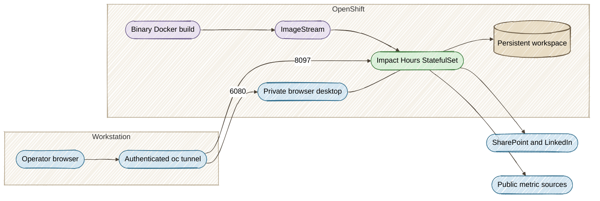

# Deploy on Red Hat OpenShift

The approved **Quarkus OpenShift extension** generates the cluster resources and builds the browser-capable image inside OpenShift. No local Docker daemon is needed for this path.

## What gets deployed

| Component | Configuration |
|---|---|
| Application | One `impact-hours` StatefulSet replica |
| Runtime | Java 25, packaged Quarkus fast-jar and web UI |
| Browsers | Bundled Playwright Chromium, Xvfb and a private noVNC desktop |
| Data | `impact-hours-data`, 10 GiB ReadWriteOnce PVC |
| App port | 8097 inside the pod |
| Sign-in desktop | 6080 on pod loopback only |
| Access | Authenticated `oc port-forward`; no public Route |
| Probes | Startup, readiness and liveness via `/api/config` |
| Security | Arbitrary non-root UID, no privilege escalation, read-only root filesystem |

Use one instance per reporting workspace. Runs, sessions and worker ownership are local to that instance. Independent workspaces need separate namespaces/PVCs rather than additional replicas.



## Prerequisites

- Java 25, Node.js 22/npm, Git and the `oc` CLI on your workstation.
- An OpenShift login with permission to create or update the project, builds, ImageStreams, StatefulSets, Services, PVCs and NetworkPolicies.
- A default storage class that can bind a ReadWriteOnce claim.
- Build and workload egress for the runtime image, browser dependencies and the metric sources.

The image uses Eclipse Temurin 25 on Ubuntu Noble to supply the browser libraries. It runs with the UID assigned by the OpenShift namespace. No `anyuid` or privileged SCC is required by the supplied configuration.

The profile aligns `quarkus.application.name` with the `impact-hours` resource name and selects the internal image registry. This keeps the BuildConfig output tag identical to the deployed container tag. Generation validates that match before any deployment.

## 1. Generate and inspect

!!! note "Generation is the default"
    Running `./deploy-openshift.sh` without an action flag only generates and validates files. **This command made no cluster changes** means that step succeeded. Use `--deploy` to actually build and deploy the workspace.

```bash
./deploy-openshift.sh --generate --namespace impact-metrics
```

This packages the app and validates the generated resources. It makes **no cluster changes**. The outputs are:

```text
target/kubernetes/openshift.yml
target/kubernetes/openshift.json
target/kubernetes/kubernetes.yml
target/kubernetes/kubernetes.json
```

`scripts/check-deployment.mjs` checks single-replica storage, probes, security context, private access and packaged instructions. The image build context contains the compiled application; local runs, uploaded workbooks and saved authentication are not copied into it.

## 2. Build and deploy

```bash
oc login <your-cluster-api>
./deploy-openshift.sh --deploy --namespace impact-metrics
```

For **Red Hat Developer Sandbox**, use the existing project assigned to your account rather than creating a new one. After signing in and selecting that project:

```bash
oc project -q
./deploy-openshift.sh --deploy --namespace "$(oc project -q)"
```

The script uses the same SDKMAN/Homebrew JDK lookup as `dev.sh`, and checks Java 25+ before packaging or changing cluster resources. An explicitly configured `JAVA_HOME` takes precedence.

The script validates the generated resources first, creates the project if needed, applies storage and the private-workspace ingress policy, then invokes the Quarkus in-cluster Docker build and deployment. It waits for the StatefulSet rollout.

Packaging skips tests; use a reviewed commit whose CI checks have passed. By default the image tag is the Git commit's short SHA. Set `--image-tag` when using a different approved tag.

```bash
./deploy-openshift.sh --status --namespace impact-metrics
oc -n impact-metrics logs -f bc/impact-hours
oc -n impact-metrics logs -f statefulset/impact-hours
```

The PVC may remain pending with a `WaitForFirstConsumer` storage class until the first pod is scheduled.

## 3. Open the app and sign-in desktop

```bash
./deploy-openshift.sh --connect --namespace impact-metrics
```

Keep that terminal open. Use two browser tabs:

- App: **[http://127.0.0.1:8097](http://127.0.0.1:8097)**
- Desktop: **[http://127.0.0.1:6080/vnc.html?autoconnect=1&resize=scale](http://127.0.0.1:6080/vnc.html?autoconnect=1&resize=scale)**

Click **Connect SharePoint** or **Connect LinkedIn** in the app. The sign-in browser opens inside the pod; complete sign-in in the desktop tab. The app checks connection progress and saves the session on the PVC. Subsequent source reads and collection reuse it.

The desktop listeners are loopback-only and are not exposed through a Service or Route. The ingress NetworkPolicy isolates the workspace. Access requires permission to port-forward to its pod.

!!! note "Local port already in use"
    Stop local dev mode before opening this tunnel, or forward the app to another local port, for example `oc -n impact-metrics port-forward --address 127.0.0.1 statefulset/impact-hours 18097:8097 6080:6080`.

## Persistent state and upgrades

The workspace at `/data/metrics` contains runs, structured results, sessions and `.chart-history/`. Current `RUN.md` and `AGENTS.md` are installed from the deployed image at startup; every existing run retains its frozen instruction copies.

Finish or cancel active work before upgrading. Deploy the next reviewed commit with the same namespace and PVC. Interrupted work remains available for an explicit **Retry phase**; a new pod does not fabricate completion.

For a team-authenticated ingress, integrate your approved gateway and adjust the network policy before exposing the app. The supplied deployment is a private reporting workspace and intentionally generates no public application Route.

See the [official Quarkus OpenShift guide](https://quarkus.io/guides/deploying-to-openshift/) and [Docker build strategy guide](https://quarkus.io/guides/deploying-to-openshift-docker-howto/) for extension details.
