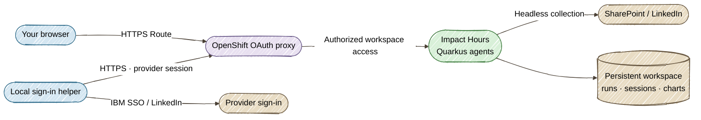

# Deploy on OpenShift

Open Impact Hours through an **HTTPS Route** and sign in with your OpenShift account. IBM SSO and LinkedIn sign-in run in a dedicated Chrome window on your computer; the pod verifies the transferred session and collects metrics headlessly. No app tunnel or VNC desktop is required.

## Workspace architecture



One StatefulSet replica mounts the existing `impact-hours-data` PVC. Run history, frozen instructions, source snapshots, chart history and saved provider sessions survive image updates. The app is one shared reporting workspace for authorized project users.

The OAuth proxy uses a namespaced ServiceAccount OAuth client and checks permission to read the `impact-hours-access` ConfigMap. Deployment grants that permission to the deploying account; users with project view, edit or admin permissions may already have it. The Service exposes only the proxy, and the NetworkPolicy admits router traffic only on port 8443. TLS is re-encrypted between the router and proxy. The app binds to pod loopback so other pods cannot bypass the proxy, even when platform NetworkPolicies allow namespace traffic. The app container does not mount the proxy's Kubernetes token.

This uses OpenShift's [service-account OAuth clients](https://docs.redhat.com/en/documentation/openshift_container_platform/4.13/html-single/authentication_and_authorization/index) and [OAuth proxy](https://github.com/openshift/oauth-proxy). It creates no cluster-wide OAuthClient or auth-delegator binding. You need project permission to create builds, ImageStreams, StatefulSets, Services, Routes, Secrets, ServiceAccounts, Roles, RoleBindings, PVCs and NetworkPolicies, plus pod exec for readiness checks. The default proxy image is read from the cluster's `openshift/oauth-proxy` ImageStream; set `METRICS_OAUTH_PROXY_IMAGE` to an approved image digest if that read is restricted.

## 1. Build and validate

Use Java 25+, Node.js 22/npm and an up-to-date `oc` CLI. Sign in to your cluster using its console's **Copy login command**. Never commit tokens or provider sessions.

```bash
# Local packaging and validation only; no cluster writes.
./deploy-openshift.sh --generate --namespace doh-dev
```

The [Quarkus OpenShift extension](https://quarkus.io/guides/deploying-to-openshift-docker-howto/) generates the build/workload resources. The script adds the protected Route configuration and validates the final manifests, single-replica storage, stateful API probes and packaged instructions. Generation uses a placeholder workspace owner; `--deploy` resolves the real owner with `oc whoami`.

The image contains Java 25, the compiled app, canonical instructions and Playwright Chromium. Xvfb, Openbox, VNC and noVNC are absent. The binary build context is **only `target/quarkus-app`**; local run data, credentials and browser profiles are excluded by construction. The Dockerfile's COPY paths are relative to this packaged context.

## 2. Deploy or update

```bash
./deploy-openshift.sh --deploy --namespace doh-dev
```

The script:

1. Packages the app and validates the secured generated resources.
2. Keeps the existing PVC and reuses the OAuth cookie Secret.
3. Applies build and Route prerequisites, then streams the packaged app with `oc start-build --follow --wait`.
4. Resolves the built image's immutable digest and applies the StatefulSet with that digest.
5. Waits for rollout and checks `/api/runs` and `/api/chart-history` inside the pod.
6. Prints the HTTPS Route URL.

A failed build stops before changing the running StatefulSet. Rerun the same command after pulling code changes; it builds and rolls out the new image without resetting history. The old tunnel command `--connect` is retained as an alias for `--url`; it now prints the Route URL and exits.

```bash
./deploy-openshift.sh --url --namespace doh-dev
./deploy-openshift.sh --status --namespace doh-dev
```

For an existing project outside Sandbox, substitute its namespace. If the project does not exist, deployment attempts `oc new-project`; your account must have project creation permission.

Optional settings:

```bash
# Grant workspace access to another explicitly selected account at deployment.
METRICS_WORKSPACE_OWNER=your-openshift-user ./deploy-openshift.sh --deploy --namespace your-project
# Pin an approved proxy image if cluster ImageStream discovery is unavailable.
METRICS_OAUTH_PROXY_IMAGE=quay.io/your-team/oauth-proxy@sha256:YOUR_DIGEST \
  ./deploy-openshift.sh --deploy --namespace your-project
```

## 3. Connect IBM and LinkedIn from your computer

Open the Route and complete **OpenShift sign-in**. Choose **Connect SharePoint** or **Connect LinkedIn**. The app shows the helper command with the correct Route and workbook URL.

From your **local checkout**, install the helper's dependency once:

```bash
npm ci --prefix src/main/webui
```

Copy the command displayed in the app. For LinkedIn, it has this shape:

```bash
node scripts/connect-browser-session.mjs \
  --app 'https://YOUR_APP_ROUTE' --provider linkedin
```

For SharePoint, the displayed command also includes `--url 'YOUR_WORKBOOK_LINK'`.

1. The helper opens a dedicated local Chrome window. Sign in to the Impact Hours Route, then press Enter in its terminal.
2. Complete IBM SSO/MFA or LinkedIn sign-in in the next tab, then press Enter to connect it.
3. The helper sends only that provider's browser storage over HTTPS. OpenShift cookies and unrelated account state are excluded. It stores no session file on your computer and closes its browser when finished.
4. The pod verifies access before saving the session to the PVC. Return to the app; connection checks refresh automatically, or click **Check connection**.

Passwords are entered directly on provider pages and never sent to the app. Provider sessions are sensitive: they stay in the guarded workspace, are not returned by APIs and are not packaged into images. IBM organizational policy or LinkedIn verification can reject a transferred session; the UI reports verification failure and offers reconnection, workbook upload or manual measurement paths as appropriate. Completing LinkedIn sign-in does not grant event analytics permissions your account lacks.

Local `./dev.sh` behavior remains unchanged: its Connect buttons open browsers locally without needing the helper. OpenShift's helper is needed only when signing in or renewing an expired session; workbook reads, publishing and collection then reuse the saved session.

## Storage and recovery

The PVC mounts at `/data/metrics`; `METRICS_RUNTIME_ROOT` is `/data/metrics/runtimes`. Keep this subdirectory so the workspace guard remains effective. Startup/readiness probes execute a loopback request to `/api/runs` inside the app container, liveness checks `/api/config`, and the OAuth proxy has its own HTTPS health probe. Writable `/tmp` and `/dev/shm` volumes support headless Chromium while the image root remains read-only.

The image supports arbitrary non-root OpenShift UIDs. Keep one replica and preserve the existing PVC during upgrades. Deleting the StatefulSet does not remove this separately managed PVC; deleting the PVC removes the saved workspace.

```bash
oc -n doh-dev get pods,pvc,route
oc -n doh-dev logs statefulset/impact-hours -c impact-hours --tail=50
oc -n doh-dev logs statefulset/impact-hours -c oauth-proxy --tail=50
```

For Route errors, check proxy readiness, serving-certificate Secret creation and the Route ingress status. For a 403 after sign-in, verify the account's access to `impact-hours-access`. Reconnecting provider sessions does not release SharePoint editing locks; wait for AutoSave and close Excel editing sessions before publishing.
