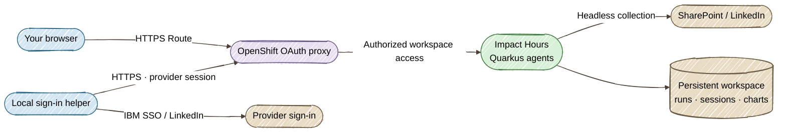

# Deploy on OpenShift

Open Impact Hours through an **HTTPS Route** and sign in with your OpenShift account. IBM SSO and LinkedIn sign-in run in a dedicated Chrome window on your computer; the pod verifies the transferred session and collects metrics headlessly. No app tunnel or VNC desktop is required.

## Workspace architecture



One StatefulSet replica mounts the existing `impact-hours-data` PVC. Run history, frozen instructions, source snapshots, chart history and saved provider sessions survive image updates. The app is one shared reporting workspace for authorized project users.

The OAuth proxy uses a namespaced ServiceAccount OAuth client and checks permission to read the `impact-hours-access` ConfigMap. Deployment grants that permission to the deploying account; users with project view, edit or admin permissions may already have it. The Service exposes only the proxy, and the NetworkPolicy admits router traffic only on port 8443. TLS is re-encrypted between the router and proxy. The app binds to pod loopback so other pods cannot bypass the proxy, even when platform NetworkPolicies allow namespace traffic. The app container does not mount the proxy's Kubernetes token. The proxy uses `--pass-host-header=false` for upstream requests: Quarkus receives the loopback Host, while OpenShift sign-in and cookies keep the public Route hostname. This preserves [Quarkus 3.40 Host validation](https://quarkus.io/version/3.40/guides/http-reference/) and prevents a post-login HTTP 400.

This uses OpenShift's [service-account OAuth clients](https://docs.redhat.com/en/documentation/openshift_container_platform/4.13/html-single/authentication_and_authorization/index) and [OAuth proxy](https://github.com/openshift/oauth-proxy). It creates no cluster-wide OAuthClient or auth-delegator binding. You need project permission to create builds, ImageStreams, StatefulSets, Services, Routes, Secrets, ServiceAccounts, Roles, RoleBindings, PVCs and NetworkPolicies, plus pod exec for readiness checks. The default proxy image is read from the cluster's `openshift/oauth-proxy` ImageStream; set `METRICS_OAUTH_PROXY_IMAGE` to an approved image digest if that read is restricted.

## 1. Build and validate

Use Java 25+, Node.js 22/npm and an up-to-date `oc` CLI. Sign in to your cluster using its console's **Copy login command**. Never commit tokens or provider sessions.

!!! note "Choose your project"
    `impact-hours` is the example project; `--namespace` accepts any valid project name. Generation does not contact the cluster and works even when that project does not exist. Deployment reuses the existing project or creates it automatically if missing; your account needs project access or creation permission. On Developer Sandbox, substitute your assigned project (check with `oc project -q`) if creating another project is restricted. For an existing workspace, use its original namespace when updating it.

```bash
# Local packaging and validation only; no cluster writes.
./deploy-openshift.sh --generate --namespace impact-hours
```

The [Quarkus OpenShift extension](https://quarkus.io/guides/deploying-to-openshift-docker-howto/) generates the build/workload resources. The script adds the protected Route configuration and validates the final manifests, single-replica storage, stateful API probes and packaged instructions. Generation uses a placeholder workspace owner; `--deploy` resolves the real owner with `oc whoami`.

The image contains Java 25, the compiled app, canonical instructions and Playwright Chromium. Xvfb, Openbox, VNC and noVNC are absent. Packaging runs in a fresh temporary source workspace, so stale `target/classes` files, saved browser profiles and run data cannot enter the build. Local dev-mode output and sessions are kept. The binary build context is **only that workspace's `target/quarkus-app`**. Validated artifacts are copied to `target/deployment/quarkus-app` and `target/deployment/kubernetes` in your checkout. The Dockerfile's COPY paths are relative to this packaged context.

## 2. Deploy or update

Model review is enabled by default in `application-openshift.properties`. Before deploying, create an **Opaque Secret** named `impact-hours-model` in the target project, with key `METRICS_MODEL_API_KEY` containing your API key. Use the OpenShift console's Secret form or a protected local file; do not commit the key. The generated OpenShift and Kubernetes workloads inject this key as an environment variable through `secretKeyRef`. No model key is included in the image or manifests, and the application needs no Kubernetes API permissions to read it.

The default endpoint is `https://api.openai.com/v1`, with model `gpt-4o-mini`. Override `METRICS_MODEL_BASE_URL` and `METRICS_MODEL_NAME` in the workload environment for another OpenAI-compatible endpoint. `METRICS_AI_ENABLED=false` skips reviews; the required Secret reference remains. Instruction review runs in Phase 1; quality review runs during validation of each phase. Model failures fall back to deterministic processing. A completed historical report is not retroactively reviewed.

```bash
./deploy-openshift.sh --deploy --namespace impact-hours
```

The script:

1. Packages the app in a fresh temporary workspace and validates the secured generated resources and archive contents, then checks the requested project. If missing, it creates it with `oc new-project --skip-config-write`, preserving the project selected in your local `oc` configuration.
2. Keeps the existing PVC and reuses the OAuth cookie Secret.
3. Applies build and Route prerequisites, then streams the packaged app with `oc start-build --follow --wait`.
4. Resolves the built image's immutable digest and applies the StatefulSet with that digest.
5. Waits for rollout and checks `/api/runs` and `/api/chart-history` inside the pod.
6. Prints the HTTPS Route URL.

A failed build stops before changing the running StatefulSet. Rerun the same command after pulling code changes; it builds and rolls out the new image without resetting history. The old tunnel command `--connect` is retained as an alias for `--url`; it now prints the Route URL and exits.

```bash
./deploy-openshift.sh --url --namespace impact-hours
./deploy-openshift.sh --status --namespace impact-hours
```

Substitute your chosen project throughout these examples. `--generate` leaves the cluster untouched; `--deploy` creates a missing project and reuses an existing one. The project lookup distinguishes a missing project from permission or connectivity failures. A failed lookup or denied project creation stops before app resources are applied and prints recovery guidance; your account must have project creation permission.

Optional settings:

```bash
# Grant workspace access to another explicitly selected account at deployment.
METRICS_WORKSPACE_OWNER=your-openshift-user ./deploy-openshift.sh --deploy --namespace impact-hours
# Pin an approved proxy image if cluster ImageStream discovery is unavailable.
METRICS_OAUTH_PROXY_IMAGE=quay.io/your-team/oauth-proxy@sha256:YOUR_DIGEST \
  ./deploy-openshift.sh --deploy --namespace impact-hours
```

## 3. Connect IBM and LinkedIn from your computer

Open the Route and complete **OpenShift sign-in**. Choose **Connect SharePoint** or **Connect LinkedIn**. The app shows the helper command with the correct Route and workbook URL. The SharePoint connection section also links to this **Local sign-in helper guide**. **Connect SharePoint** reveals the instructions even when a saved session is already connected, so you can renew sign-in when needed.

### Install Chrome on the computer running the helper

The helper requires **Google Chrome desktop**, Node.js 22+ with npm, and a local project checkout. These client requirements apply to both IBM SSO and LinkedIn sign-in; Java and `oc` are needed for building/deploying the app, not for running the helper. `npm ci` installs JavaScript dependencies and does **not** install Chrome.

1. [Download Google Chrome](https://www.google.com/chrome/) using Google's [macOS and Windows installation guide](https://support.google.com/chrome/answer/95346).
2. **macOS:** open the downloaded `.dmg`, move Chrome into **Applications**, then launch it once. **Windows:** run the downloaded installer, finish installation, then launch Chrome once.
3. Return to Terminal on macOS or PowerShell on Windows, open the project directory, install the helper dependencies below, and paste the one-line command shown in the app.

Without Chrome installed, the helper stops before opening the app or provider sign-in page and prints installation links. It launches a separate Chrome window; your existing Chrome tabs and sign-ins are not reused. The SharePoint, LinkedIn and DZone helpers share a dedicated local OpenShift app session for the same Route. Installing Chromium for tests does not satisfy this helper's Chrome requirement.

From your **local checkout**, install the helper's dependency once:

```bash
npm ci --prefix src/main/webui
```

Copy the command displayed in the app. For LinkedIn, it has this shape:

```bash
node scripts/connect-browser-session.mjs \
  --app 'https://YOUR_APP_ROUTE' --provider linkedin
```

For SharePoint, the displayed command also includes `--url 'YOUR_WORKBOOK_LINK'`.

1. The helper opens a dedicated local Chrome window. On first use, sign in to the Impact Hours Route, then press Enter in its terminal. Subsequent SharePoint, LinkedIn and DZone helper commands reuse that verified OpenShift session and skip this prompt while it remains valid. An expired or rejected app session prompts for sign-in again.
2. Complete IBM SSO/MFA or LinkedIn sign-in in the separate provider window, then press Enter to connect it.
3. The helper sends only that provider's browser storage over HTTPS. OpenShift cookies and unrelated account state are excluded. Provider sessions use separate temporary browser contexts. Only the Route's app authentication is cached locally in `~/.impact-hours/helper-app-sessions/`, with owner-only file permissions on macOS/Linux; the cache is scoped separately to each Route and never uploaded. The browser closes when finished.

To connect as a different OpenShift user, append `--forget-app-session` to either helper command. This removes that Route's local app session before opening Chrome and does not reset the app's runs or saved provider connections. The server checks app access on every helper invocation; cached authentication does not grant access after it is revoked. Local dev Connect buttons are unchanged.

If the helper shows **403 Permission Denied — csrf failed**, close that helper window, update your local checkout with `git pull`, and rerun the command. Finish sign-in only in the newly opened window; avoid reusing an old OAuth callback tab or starting parallel login flows. The helper checks the proxy's `/oauth/auth` endpoint without redirects before requesting app configuration, so its access check does not replace the pending login's CSRF cookie. Transient CSRF cookies are excluded from the saved app session. This helper fix needs no pod redeployment and keeps the proxy's CSRF protection enabled.
4. The pod verifies access before saving the session to the PVC. Return to the app; connection checks refresh automatically, or click **Check connection**.

Passwords are entered directly on provider pages and never sent to the app. Provider sessions are sensitive: they stay in the guarded workspace, are not returned by APIs and are not packaged into images. IBM organizational policy or LinkedIn verification can reject a transferred session. Completing LinkedIn sign-in does not grant event analytics permissions your account lacks.

SharePoint verification uses the same REST, download-page and workbook-link refresh flow as ordinary workbook reads; it saves the transferred session only after downloading a valid workbook. Wait until the workbook opens in the helper's IBM tab before pressing Enter. The helper first checks a workbook download using the filtered session in a fresh local browser context. Only after that check succeeds does it send the session to the pod for the same verification. The terminal distinguishes a local download failure from a pod failure after local success. The helper closes its Chrome window when it finishes, including on failure.

The transfer preserves IBM-host `FedAuth` and SharePoint's named root `rtFa` cookie for [SharePoint sign-in continuity](https://learn.microsoft.com/en-us/sharepoint/authentication). A root cookie alone cannot confirm IBM sign-in. Unrelated root cookies, Microsoft login-site storage and OpenShift login state are excluded.

Pull and redeploy the latest app before using its updated helper. The helper checks server support after OpenShift sign-in; an older pod stops the flow before IBM sign-in or session transfer, with an instruction to update the app.

A failure message with **HTTP 401** means the request was rejected as unauthenticated; **HTTP 403** means access was denied; **HTTP 404** means the workbook link needs checking. If the transfer-ready session downloads the workbook locally but the pod continues to receive 401/403, the two environments are producing different results. That alone does not prove an IBM policy restriction: investigate server session compatibility and ask your IBM administrator to check cluster access policies and sign-in logs. Repeating sign-in does not override organizational policy.

Local `./dev.sh` behavior remains unchanged: its Connect buttons open browsers locally without needing the helper. OpenShift's helper is needed only when signing in or renewing an expired session; workbook reads, publishing and collection then reuse the saved session.

## Automatic YouTube views

YouTube public video views use the automatic collector in OpenShift, with no YouTube sign-in helper. It verifies the requested video and reads its exact lifetime Views, including comma-separated counters. If YouTube withholds the counter, retry unresolved collection or supply verified views. Update and redeploy before retrying; completed runs retain their saved measurements, so use a new run or a verified reporting correction for previously misread totals.

## Collect DZone views from your computer

If the pod's headless DZone collection returns HTTP 403, the OpenShift UI offers **Collect DZone views locally** beside LinkedIn. The next-action bar highlights it during a Phase 1 or Phase 4 review with pending DZone article views. This is public counter collection, not a DZone account connection: the helper sends measured totals, never browser cookies.

1. Click **Collect DZone views locally** and copy its run-specific command into Terminal or PowerShell from your project checkout. Desktop Google Chrome and the same `npm ci --prefix src/main/webui` setup are required.
2. Sign in to the OpenShift app in the helper's Chrome window, then press Enter. A separate isolated context reads each pending article's public Views counter.
3. Review the printed whole-article totals and approximation labels, then type `yes` to save the batch. Any other answer cancels without changes.
4. The app recalculates once and refreshes automatically. Existing author/tool attribution, previous baselines, and data review rules still apply. Use the helper again for a later collection phase if needed.

The helper stops without saving if a page is blocked or its counter is ambiguous. It does not transfer cookies, change fingerprints, or solve challenges. Use the existing manual measurement action if the local browser cannot collect the counter. This feature defaults off in local dev mode and portable Kubernetes; the protected OpenShift deployment enables it.

## Storage and recovery

The PVC mounts at `/data/metrics`; `METRICS_RUNTIME_ROOT` is `/data/metrics/runtimes`. Keep this subdirectory so the workspace guard remains effective. Startup/readiness probes execute a loopback request to `/api/runs` inside the app container, liveness checks `/api/config`, and the OAuth proxy has its own HTTPS health probe. Writable `/tmp` and `/dev/shm` volumes support headless Chromium while the image root remains read-only.

The image supports arbitrary non-root OpenShift UIDs. Keep one replica and preserve the existing PVC during upgrades. Deleting the StatefulSet does not remove this separately managed PVC; deleting the PVC removes the saved workspace.

```bash
oc -n impact-hours get pods,pvc,route
oc -n impact-hours logs statefulset/impact-hours -c impact-hours --tail=50
oc -n impact-hours logs statefulset/impact-hours -c oauth-proxy --tail=50
```

For Route errors, check proxy readiness, serving-certificate Secret creation and the Route ingress status. For a 403 after sign-in, verify the account's access to `impact-hours-access`. Reconnecting provider sessions does not release SharePoint editing locks; wait for AutoSave and close Excel editing sessions before publishing.
