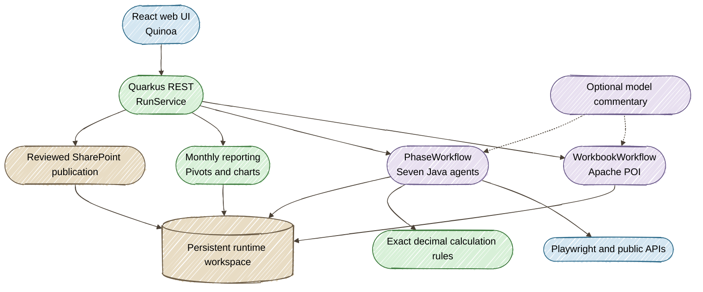

# Architecture

The application separates workbook preparation, collection, calculation and reporting. Persistent state is filesystem-based; it does not require PostgreSQL or a Dev Services database.



## Execution ownership

`RunService` calls `PhaseWorkflow` for each phase. LangChain4j Agentic supplies the sequence of instruction, digital, attendance, attribution, trailing, export and validation agents. Java rules determine metrics and enforce conservation.

An automatic run advances when the phase's review list is empty. Automatic transitions are recorded separately from human approvals. Readiness and worker release happen under the same run lock, so an awaiting-approval state can accept its next action immediately.

A restart interrupts an active worker. On loading that run, the app offers retry from the saved immutable phase inputs. It does not silently mark the phase complete.

## Browser placement

On a laptop, the sign-in browsers run locally. On a cluster, they run in the pod's private desktop. SharePoint storage state and LinkedIn browser profiles are kept with the workspace. Collection can run headlessly after authentication; DZone uses the supplied background settings and reports blocked collection as a review item.

## State layout

```text
runtimes/                    # /data/metrics in the cluster
  RUN.md
  AGENTS.md
  runs/<run-id>/
    rawdata/                 # immutable imported workbook bytes
    instructions/            # per-run frozen rules
    state/                   # source rows, phase state and measurements
    output/<version>/        # structured result datasets
    publication/             # reviewed candidates, before copies and receipts
  .sessions/                 # private browser/session state
  .uploads/                  # temporary source downloads
  .chart-history/            # durable published chart-history cache
```

CSV and ZIP downloads are generated from structured results. The app's working pipeline does not use exported CSV files as intermediate state.

## One workspace per instance

The in-memory worker ownership and filesystem state belong to one JVM. The provided StatefulSet runs one replica against one PVC. Use separate workspaces for independent operators. Horizontal scaling requires a shared execution/state design and is outside this deployment configuration.
