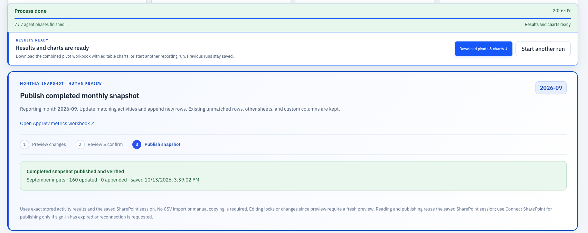

# Use pivots and charts

The monthly report combines eligible current contributions and fresh trailing growth. It applies the selected metric model and counts an overlapping activity attribution once.

## Run during the month or at month-end

You can run October’s report on October 13, October 20, and October 31. Each run reads fresh workbook snapshots and freezes its reporting date. Dated current activities through that date and measured trailing growth contribute to its tables and charts. Future-dated activities wait for a later run.

Before the last day, the report, Excel export and publication panel identify a **provisional snapshot**. Publishing it updates or appends the monthly input data without deleting existing rows. Later runs update the same tab, including refreshed historical cumulative totals. A row previously carried as a baseline is updated when new growth is measured. A run on the last day or later produces the **final month-end snapshot** (for example, October 31 or November 1 for October). Reopening an October 13 run never promotes it to final.

An interim run can show **Process done**: that run’s processing and publication have finished, while the month’s totals remain provisional. Download its results or choose **Start another run** for fresh measurements. A later month requires a published final baseline. Older provisional publications cannot overwrite a newer snapshot or a final one.

## Recognize a completed run

Completion state for a September run. The publication receipt records the updated sheet, row counts and verification time; these are workflow details, not impact-hour totals.

Look for the green **Process done** status and **Results and charts are ready**. For a SharePoint run, also check **Completed snapshot published and verified** in the monthly publication panel. Seven finished agent phases alone do not confirm that this final snapshot has been published.

!!! success "Choose your next action"
    - **Download pivots & charts** saves the combined Excel report with editable charts, pivot tables and reporting detail.
    - **Start another run** reads fresh workbook snapshots. You can keep the same month or choose the next one; previous runs, saved sign-in sessions and chart history remain available.

If the monitor still asks for a review or publication, finish that action first. Saving a reporting correction recalculates the charts and invalidates an earlier completed publication; preview and publish the revised snapshot, then download a fresh report.

## Inspect before sharing

Fictional report. Values demonstrate the UI; they are not published team metrics.

Use the channel and tool tables to inspect impact. Contributor filters show the exact activities and source datasets behind a tool total. Published comparisons show differences; the app keeps recalculated values rather than forcing them to match an older published table.

Charts show individual months from September 2025 to the selected month:

1. **Impact hours by channel** — activity types.
2. **Impact hours by tool** — attributed tools.
3. An optional **IBM Bob** view by activity type.

The selected month uses the current calculation. Earlier months use the saved published history.

## Download the pivot workbook

Use **Download pivots & charts** in the completed-run bar, or the report's XLSX download action. `monthly-report-combined.xlsx` is the preferred artifact for editable tables, pivots and Excel charts.

To share in Word, copy the chart from Excel and choose your desired paste behavior: a linked/embedded Excel chart for editing, or an image for a fixed presentation. A UI screenshot is useful for showing the application itself, but it is not an editable chart.

## CSV outputs

| Download | Contains |
|---|---|
| `digital.csv` | Current digital contributions and collection evidence |
| `in-person.csv` | Current in-person calculations and attribution |
| `follow-up.csv` | Unresolved or other follow-up activities |
| `current.csv` | Combined current-month output |
| `updated_90-day.csv` | Historical totals, baselines, deltas and provenance |

CSV files are created in memory when downloaded. Structured source and result datasets are the working state; the pipeline does not generate intermediate CSV files on disk.

## Provisional reporting

Reporting attention identifies excluded values that need a correction. A confirmable row shows the original resource URL, workbook/sheet/row, baseline, allocated total and collection timestamp. Saving a valid correction recalculates tables and charts.

A checkbox cannot resolve a negative delta. If an attributed cumulative total is below its previous baseline, verify the allocation and correct the measurement or source baseline. Never increase a count solely to pass validation.

## Start another run

Use **Start another run** to re-read the sources, even for the same reporting month. Previous results remain saved. This is different from **Reset run history**, which deletes saved run data.
