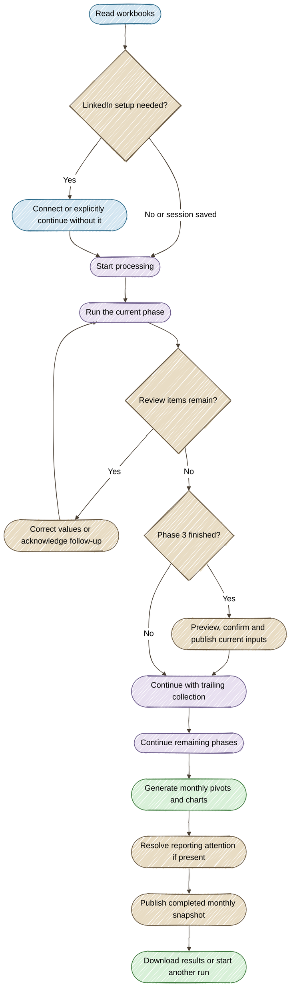
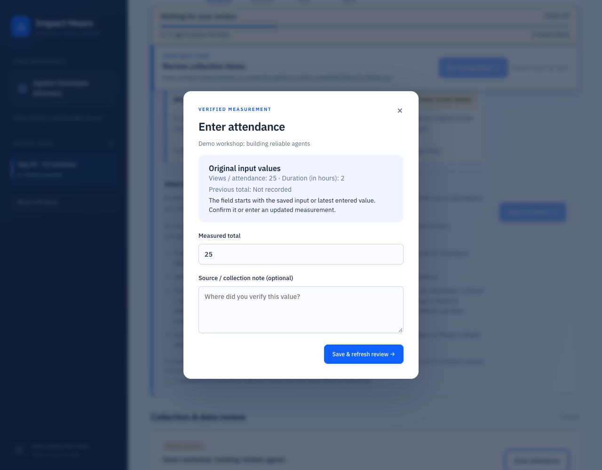

# Follow the automatic workflow

Prepared inputs start processing automatically. The backend advances clean phases and records each transition. You intervene when a metric or source needs review, or when publishing a workbook update.

## Seven agent phases

| Phase | Work | When it pauses |
|---|---|---|
| 1 · Digital collection | Collect supported views, reactions, stars or downloads | Unavailable collection or invalid input |
| 2 · In-person attendance | Calculate attendance or the supplied monthly aggregate | Invalid attendance or required follow-up |
| 3 · Attribution | Split explicit authors × tools with conserved totals | Attribution or data review; then current-input publication |
| 4 · Trailing history | Collect and allocate cumulative totals, subtract baselines | Missing totals, invalid baselines or unresolved evidence |
| 5 · Other activities | Retain follow-up activities | Existing review decisions are preserved |
| 6 · Combine exports | Combine current-month results | A processing error |
| 7 · Current totals | Build final current results and validate them | A processing error |

## Monitor without scrolling back

Demo collection progress. Resource counts are synthetic.

The sticky bar shows:

- The current phase and completed agent-phase count.
- Real completed/total resource checks during collection.
- Review, publication and chart-generation states.
- **Process done** once reporting and required publication are complete.

Seven finished agent phases do not mean the completed monthly snapshot has been saved yet. Follow the monitor's publication action until the panel shows **Completed snapshot published and verified**. Once the whole run is complete, the bar offers **Download pivots & charts** and **Start another run**. See the [completed-run screenshot and next actions](reports.md#recognize-a-completed-run).

## Review only the items that need a decision

Demo review item. No team measurements are shown.

Correct blocking numeric values before continuing. For unavailable collection, enter a verified measurement or explicitly acknowledge retaining the item for follow-up. The app does not acknowledge that choice for you.

When the last issue is resolved, automatic processing resumes. An open measurement dialog pauses UI transitions until the dialog is saved or closed.

**Already counted** means the eligible contribution is included once elsewhere, usually in current results. **No new contribution** means retained historical input does not establish new growth. These reference rows do not need confirmation and add zero additional impact hours.

## Publish at the two checkpoints

After Phase 3, preview and confirm the current-input update before trailing collection. After reporting is complete, publish the **completed monthly snapshot**.

Publication updates matching attributions and appends new ones. It preserves unmatched rows, custom columns and other sheets. It uses a live preview hash, checkout, upload verification and check-in. A stale preview, editing lock or ambiguous attribution stops publication for review.
